# Travel Crumbs 논리·물리 데이터 모델 v0.2

작성일: 2026-11-06  
기준 문서: Travel Crumbs 통합 와이어프레임 A4 v4, Travel Crumbs 데이터 표준 정의서 v0.2

## 1. 모델링 기준

- ERD와 정의서의 테이블명·컬럼명은 대문자 표기
- 실제 DB 물리명은 소문자 snake_case 적용
- 기본키는 엔티티명과 번호를 결합한 `NO` 사용
- 로그인 식별자는 `LOGIN_ID` 사용
- 외래키는 참조 대상 기본키의 컬럼명 유지
- 동일 테이블을 여러 역할로 참조할 경우 역할명 접두어 사용
- 실제 장소 기준정보와 여행별 장소 기록 분리
- 여행별 장소 기록과 경험 정보 통합
- 원본 경로점과 간소화 경로 분리
- 업무 상태 변화는 이력 테이블(HIST)에 추가 저장
- 시스템 요청과 처리 결과는 로그 테이블(LOG)에 추가 저장
- 이력 테이블(HIST)과 로그 테이블(LOG)은 수정·논리 삭제 없이 추가만 허용

## 2. 테이블 유형

| 유형 | 의미 | 적용 기준 |
|---|---|---|
| MST | 기준·주요 객체 | 독립적으로 식별하고 여러 업무에서 참조하는 데이터 |
| DTL | 상세 내역 | 상위 객체에 속하며 순서·속성·내용을 보유하는 데이터 |
| REL | 관계 | 객체 간 다대다 관계를 연결하는 데이터 |
| HIST | 이력 | 동일 업무 객체의 상태·값 변경을 시간순으로 저장하는 데이터 |
| LOG | 로그 | 시스템 요청·응답·오류·처리 결과를 건별로 저장하는 데이터 |

## 3. ERD

```mermaid
erDiagram
    USER_MST ||--o{ USER_VEHICLE_DTL : "차량 연결"
    VEHICLE_MST ||--o{ USER_VEHICLE_DTL : "사용자 연결"
    USER_MST ||--o{ TRIP_MST : "여행 소유"
    USER_MST ||--o{ CONSENT_HIST : "동의 변경"
    USER_MST ||--o{ ROUTE_SEARCH_COND_MST : "경로 검색"
    USER_MST ||--o{ PLANNED_ROUTE_MST : "경로 계획"
    USER_MST ||--o{ TRIP_SHARE_MST : "공유 발신"
    USER_MST ||--o{ TRIP_SHARE_MST : "공유 수신"
    USER_MST ||--o{ NAVI_REQ_LOG : "길안내 요청"

    TRIP_MST ||--o{ TRIP_COMPANION_DTL : "동행자 구성"
    TRIP_MST ||--o{ ROUTE_POINT_DTL : "원본 경로점"
    TRIP_MST ||--o| TRIP_ROUTE_DTL : "간소화 경로"
    TRIP_MST ||--o{ TRIP_PLACE_DTL : "방문 장소"
    TRIP_MST ||--o{ TRIP_STATUS_HIST : "상태 변경"
    TRIP_MST ||--o{ TRIP_SHARE_MST : "원본 여행"
    TRIP_MST |o--o| TRIP_SHARE_MST : "수락 복제본"

    PLACE_MST ||--o{ PLACE_FACILITY_DTL : "편의시설"
    PLACE_MST |o--o{ TRIP_PLACE_DTL : "실제 장소 연결"
    TRIP_PLACE_DTL ||--o{ TRIP_PLACE_TAG_REL : "경험 태그"
    TAG_MST ||--o{ TRIP_PLACE_TAG_REL : "태그 연결"

    ROUTE_SEARCH_COND_MST ||--o{ ROUTE_SEARCH_COND_TAG_REL : "중요 조건"
    TAG_MST ||--o{ ROUTE_SEARCH_COND_TAG_REL : "조건 태그"
    ROUTE_SEARCH_COND_MST ||--o{ ROUTE_MATCH_DTL : "유사 여행"
    TRIP_MST ||--o{ ROUTE_MATCH_DTL : "매칭 여행"
    ROUTE_SEARCH_COND_MST ||--o{ ROUTE_RECO_MST : "추천 결과"
    ROUTE_RECO_MST ||--o{ ROUTE_RECO_PLACE_DTL : "추천 장소"
    PLACE_MST ||--o{ ROUTE_RECO_PLACE_DTL : "장소 연결"

    ROUTE_RECO_MST |o--o{ PLANNED_ROUTE_MST : "추천 출처"
    PLANNED_ROUTE_MST ||--o{ PLANNED_ROUTE_PLACE_DTL : "계획 장소"
    PLACE_MST ||--o{ PLANNED_ROUTE_PLACE_DTL : "장소 연결"
    PLANNED_ROUTE_MST |o--o| TRIP_MST : "실행 여행"

    PLACE_MST |o--o{ NAVI_REQ_LOG : "단일 목적지"
    PLANNED_ROUTE_MST |o--o{ NAVI_REQ_LOG : "다중 장소 경로"

    CD_GRP_MST ||--o{ CD_DTL : "코드 구성"

    USER_MST {
        BIGINT USER_NO PK
        VARCHAR LOGIN_ID UK
        VARCHAR PASSWORD_HASH
        VARCHAR NICKNAME_NM
        TIMESTAMPTZ CREATED_AT
        BIGINT CREATED_USER_NO
        TIMESTAMPTZ UPDATED_AT
        BIGINT UPDATED_USER_NO
        CHAR DELETED_YN
    }

    VEHICLE_MST {
        BIGINT VEHICLE_NO PK
        VARCHAR VEHICLE_NM
        VARCHAR VEHICLE_MODEL_NM
        TIMESTAMPTZ CREATED_AT
        BIGINT CREATED_USER_NO
        TIMESTAMPTZ UPDATED_AT
        BIGINT UPDATED_USER_NO
        CHAR DELETED_YN
    }

    USER_VEHICLE_DTL {
        BIGINT USER_VEHICLE_NO PK
        BIGINT USER_NO FK
        BIGINT VEHICLE_NO FK
        CHAR DEFAULT_YN
        TIMESTAMPTZ CREATED_AT
        BIGINT CREATED_USER_NO
        TIMESTAMPTZ UPDATED_AT
        BIGINT UPDATED_USER_NO
        CHAR DELETED_YN
    }

    TRIP_MST {
        BIGINT TRIP_NO PK
        CHAR TRIP_UUID UK
        BIGINT USER_NO FK
        VARCHAR TRIP_NM
        VARCHAR TRIP_STATUS_CD
        VARCHAR VISIBILITY_CD
        TIMESTAMPTZ START_AT
        TIMESTAMPTZ END_AT
        INTEGER DIST
        INTEGER DURATION
        INTEGER TRIP_PLACE_CNT
        TIMESTAMPTZ CREATED_AT
        BIGINT CREATED_USER_NO
        TIMESTAMPTZ UPDATED_AT
        BIGINT UPDATED_USER_NO
        CHAR DELETED_YN
    }

    TRIP_COMPANION_DTL {
        BIGINT TRIP_COMPANION_NO PK
        BIGINT TRIP_NO FK
        VARCHAR COMPANION_TYPE_CD
        INTEGER COMPANION_CNT
        TIMESTAMPTZ CREATED_AT
        BIGINT CREATED_USER_NO
        TIMESTAMPTZ UPDATED_AT
        BIGINT UPDATED_USER_NO
        CHAR DELETED_YN
    }

    ROUTE_POINT_DTL {
        BIGINT ROUTE_POINT_NO PK
        BIGINT TRIP_NO FK
        DECIMAL LAT
        DECIMAL LNG
        TIMESTAMPTZ RECORDED_AT
        INTEGER POINT_ORD
        TIMESTAMPTZ CREATED_AT
        BIGINT CREATED_USER_NO
    }

    TRIP_ROUTE_DTL {
        BIGINT TRIP_ROUTE_NO PK
        BIGINT TRIP_NO FK,UK
        TEXT ROUTE_DATA
        VARCHAR ROUTE_DATA_FORMAT_CD
        TIMESTAMPTZ CREATED_AT
        BIGINT CREATED_USER_NO
        TIMESTAMPTZ UPDATED_AT
        BIGINT UPDATED_USER_NO
    }

    PLACE_MST {
        BIGINT PLACE_NO PK
        VARCHAR PLACE_NM
        VARCHAR PLACE_TYPE_CD
        VARCHAR PLACE_SOURCE_CD
        VARCHAR EXT_PLACE_ID
        DECIMAL LAT
        DECIMAL LNG
        TIMESTAMPTZ SOURCE_UPDATED_AT
        TIMESTAMPTZ CREATED_AT
        BIGINT CREATED_USER_NO
        TIMESTAMPTZ UPDATED_AT
        BIGINT UPDATED_USER_NO
        CHAR DELETED_YN
    }

    PLACE_FACILITY_DTL {
        BIGINT PLACE_FACILITY_NO PK
        BIGINT PLACE_NO FK
        VARCHAR FACILITY_TYPE_CD
        CHAR AVAILABLE_YN
        VARCHAR FACILITY_MEMO
        TIMESTAMPTZ VERIFIED_AT
        TIMESTAMPTZ CREATED_AT
        BIGINT CREATED_USER_NO
        TIMESTAMPTZ UPDATED_AT
        BIGINT UPDATED_USER_NO
        CHAR DELETED_YN
    }

    TRIP_PLACE_DTL {
        BIGINT TRIP_PLACE_NO PK
        BIGINT TRIP_NO FK
        BIGINT PLACE_NO FK
        DECIMAL RECORDED_LAT
        DECIMAL RECORDED_LNG
        TIMESTAMPTZ RECORDED_AT
        INTEGER VISIT_ORD
        CHAR DRAFT_YN
        VARCHAR MEMO
        VARCHAR REVIEW_POLARITY_CD
        CHAR REVISIT_YN
        TIMESTAMPTZ CREATED_AT
        BIGINT CREATED_USER_NO
        TIMESTAMPTZ UPDATED_AT
        BIGINT UPDATED_USER_NO
        CHAR DELETED_YN
    }

    TAG_MST {
        BIGINT TAG_NO PK
        VARCHAR TAG_NM UK
        CHAR USE_YN
        TIMESTAMPTZ CREATED_AT
        BIGINT CREATED_USER_NO
        TIMESTAMPTZ UPDATED_AT
        BIGINT UPDATED_USER_NO
    }

    TRIP_PLACE_TAG_REL {
        BIGINT TRIP_PLACE_TAG_NO PK
        BIGINT TRIP_PLACE_NO FK
        BIGINT TAG_NO FK
        TIMESTAMPTZ CREATED_AT
        BIGINT CREATED_USER_NO
    }

    TRIP_SHARE_MST {
        BIGINT TRIP_SHARE_NO PK
        BIGINT TRIP_NO FK
        BIGINT SENDER_USER_NO FK
        BIGINT RECEIVER_USER_NO FK
        BIGINT COPY_TRIP_NO FK
        VARCHAR SHARE_STATUS_CD
        TIMESTAMPTZ SHARED_AT
        TIMESTAMPTZ ACCEPTED_AT
        TIMESTAMPTZ CREATED_AT
        BIGINT CREATED_USER_NO
        TIMESTAMPTZ UPDATED_AT
        BIGINT UPDATED_USER_NO
        CHAR DELETED_YN
    }

    ROUTE_SEARCH_COND_MST {
        BIGINT ROUTE_SEARCH_COND_NO PK
        BIGINT USER_NO FK
        DECIMAL DEP_LAT
        DECIMAL DEP_LNG
        DECIMAL DEST_LAT
        DECIMAL DEST_LNG
        VARCHAR COMPANION_TYPE_CD
        TIMESTAMPTZ CREATED_AT
        BIGINT CREATED_USER_NO
        TIMESTAMPTZ UPDATED_AT
        BIGINT UPDATED_USER_NO
        CHAR DELETED_YN
    }

    ROUTE_SEARCH_COND_TAG_REL {
        BIGINT ROUTE_SEARCH_COND_TAG_NO PK
        BIGINT ROUTE_SEARCH_COND_NO FK
        BIGINT TAG_NO FK
        TIMESTAMPTZ CREATED_AT
        BIGINT CREATED_USER_NO
    }

    ROUTE_MATCH_DTL {
        BIGINT ROUTE_MATCH_NO PK
        BIGINT ROUTE_SEARCH_COND_NO FK
        BIGINT TRIP_NO FK
        DECIMAL SIMILARITY
        TIMESTAMPTZ CREATED_AT
        BIGINT CREATED_USER_NO
    }

    ROUTE_RECO_MST {
        BIGINT ROUTE_RECO_NO PK
        BIGINT ROUTE_SEARCH_COND_NO FK
        VARCHAR RECO_TYPE_CD
        INTEGER TRIP_CNT
        INTEGER DURATION
        TIMESTAMPTZ CREATED_AT
        BIGINT CREATED_USER_NO
        TIMESTAMPTZ UPDATED_AT
        BIGINT UPDATED_USER_NO
        CHAR DELETED_YN
    }

    ROUTE_RECO_PLACE_DTL {
        BIGINT ROUTE_RECO_PLACE_NO PK
        BIGINT ROUTE_RECO_NO FK
        BIGINT PLACE_NO FK
        INTEGER ROUTE_ORD
        TIMESTAMPTZ CREATED_AT
        BIGINT CREATED_USER_NO
    }

    PLANNED_ROUTE_MST {
        BIGINT PLANNED_ROUTE_NO PK
        BIGINT USER_NO FK
        BIGINT ROUTE_RECO_NO FK
        BIGINT TRIP_NO FK
        VARCHAR PLANNED_ROUTE_NM
        TIMESTAMPTZ CREATED_AT
        BIGINT CREATED_USER_NO
        TIMESTAMPTZ UPDATED_AT
        BIGINT UPDATED_USER_NO
        CHAR DELETED_YN
    }

    PLANNED_ROUTE_PLACE_DTL {
        BIGINT PLANNED_ROUTE_PLACE_NO PK
        BIGINT PLANNED_ROUTE_NO FK
        BIGINT PLACE_NO FK
        INTEGER ROUTE_ORD
        TIMESTAMPTZ CREATED_AT
        BIGINT CREATED_USER_NO
        TIMESTAMPTZ UPDATED_AT
        BIGINT UPDATED_USER_NO
        CHAR DELETED_YN
    }

    CONSENT_HIST {
        BIGINT CONSENT_HIST_NO PK
        BIGINT USER_NO FK
        VARCHAR CONSENT_TYPE_CD
        CHAR CONSENT_YN
        TIMESTAMPTZ CONSENT_AT
        BIGINT CREATED_USER_NO
        TIMESTAMPTZ CREATED_AT
    }

    TRIP_STATUS_HIST {
        BIGINT TRIP_STATUS_HIST_NO PK
        BIGINT TRIP_NO FK
        VARCHAR BEFORE_TRIP_STATUS_CD
        VARCHAR AFTER_TRIP_STATUS_CD
        TIMESTAMPTZ CHANGED_AT
        BIGINT CHANGED_USER_NO
        TIMESTAMPTZ CREATED_AT
    }

    NAVI_REQ_LOG {
        BIGINT NAVI_REQ_LOG_NO PK
        BIGINT USER_NO FK
        BIGINT PLACE_NO FK
        BIGINT PLANNED_ROUTE_NO FK
        VARCHAR NAVI_REQ_STATUS_CD
        VARCHAR ERR_MSG
        TIMESTAMPTZ REQ_AT
        TIMESTAMPTZ RESP_AT
        TIMESTAMPTZ CREATED_AT
        BIGINT CREATED_USER_NO
    }

    CD_GRP_MST {
        BIGINT CD_GRP_NO PK
        VARCHAR CD_GRP_CD UK
        VARCHAR CD_GRP_NM
        CHAR USE_YN
        TIMESTAMPTZ CREATED_AT
        BIGINT CREATED_USER_NO
        TIMESTAMPTZ UPDATED_AT
        BIGINT UPDATED_USER_NO
    }

    CD_DTL {
        BIGINT CD_NO PK
        BIGINT CD_GRP_NO FK
        VARCHAR CD UK
        VARCHAR CD_NM
        INTEGER SORT_ORD
        CHAR USE_YN
        TIMESTAMPTZ CREATED_AT
        BIGINT CREATED_USER_NO
        TIMESTAMPTZ UPDATED_AT
        BIGINT UPDATED_USER_NO
    }
```

## 4. 테이블 목록

| 영역 | 테이블명 | 논리명 | 유형 | 주요 역할 |
|---|---|---|---|---|
| 사용자 | USER_MST | 사용자 | MST | 로그인 계정과 사용자 프로필 |
| 사용자 | VEHICLE_MST | 차량 | MST | 차량 기준정보 |
| 사용자 | USER_VEHICLE_DTL | 사용자차량내역 | DTL | 사용자와 차량 연결 |
| 여행 | TRIP_MST | 여행 | MST | 여행 기본정보와 현재 상태 |
| 여행 | TRIP_COMPANION_DTL | 여행동행자내역 | DTL | 여행별 동행자 유형과 인원 |
| 여행 | ROUTE_POINT_DTL | 경로점내역 | DTL | 주행 중 수집한 원본 위치점 |
| 여행 | TRIP_ROUTE_DTL | 여행경로내역 | DTL | 화면 표시용 간소화 경로 |
| 장소 | PLACE_MST | 장소 | MST | 여러 여행에서 공통으로 참조하는 실제 장소 |
| 장소 | PLACE_FACILITY_DTL | 장소편의시설내역 | DTL | 장소별 편의시설 정보 |
| 장소 | TRIP_PLACE_DTL | 여행장소내역 | DTL | 여행별 방문 장소와 경험 |
| 장소 | TAG_MST | 태그 | MST | 경험·검색 조건 태그 |
| 장소 | TRIP_PLACE_TAG_REL | 여행장소태그관계 | REL | 여행장소와 태그 연결 |
| 공유 | TRIP_SHARE_MST | 여행공유 | MST | 여행 공유·수락·복제 상태 |
| 추천 | ROUTE_SEARCH_COND_MST | 경로검색조건 | MST | 출발지·목적지·동행자 조건 |
| 추천 | ROUTE_SEARCH_COND_TAG_REL | 경로검색조건태그관계 | REL | 검색조건과 중요 태그 연결 |
| 추천 | ROUTE_MATCH_DTL | 경로매칭내역 | DTL | 검색조건과 유사한 여행 및 유사도 |
| 추천 | ROUTE_RECO_MST | 경로추천 | MST | 유형별 추천 결과 |
| 추천 | ROUTE_RECO_PLACE_DTL | 경로추천장소내역 | DTL | 추천 경로를 구성하는 장소와 순서 |
| 계획 | PLANNED_ROUTE_MST | 계획경로 | MST | 사용자가 선택해 저장한 경로 |
| 계획 | PLANNED_ROUTE_PLACE_DTL | 계획경로장소내역 | DTL | 계획 경로에 포함된 장소와 순서 |
| 이력 | CONSENT_HIST | 동의이력 | HIST | 위치·공개 동의와 철회 이력 |
| 이력 | TRIP_STATUS_HIST | 여행상태이력 | HIST | 여행 상태 변경 전·후 값 |
| 로그 | NAVI_REQ_LOG | 길안내요청로그 | LOG | NaviHelper 요청·응답·오류 결과 |
| 공통 | CD_GRP_MST | 코드그룹 | MST | 코드 그룹 기준정보 |
| 공통 | CD_DTL | 코드내역 | DTL | 코드값·코드명·정렬순서 |

## 5. 주요 제약조건

| 테이블명 | 제약조건 |
|---|---|
| USER_MST | `LOGIN_ID` UNIQUE |
| TRIP_MST | `TRIP_UUID` UNIQUE |
| USER_VEHICLE_DTL | `(USER_NO, VEHICLE_NO)` UNIQUE |
| TRIP_ROUTE_DTL | `TRIP_NO` UNIQUE |
| PLACE_MST | `(PLACE_SOURCE_CD, EXT_PLACE_ID)` UNIQUE |
| TRIP_PLACE_TAG_REL | `(TRIP_PLACE_NO, TAG_NO)` UNIQUE |
| ROUTE_SEARCH_COND_TAG_REL | `(ROUTE_SEARCH_COND_NO, TAG_NO)` UNIQUE |
| ROUTE_MATCH_DTL | `(ROUTE_SEARCH_COND_NO, TRIP_NO)` UNIQUE |
| ROUTE_RECO_PLACE_DTL | `(ROUTE_RECO_NO, PLACE_NO)` UNIQUE |
| PLANNED_ROUTE_PLACE_DTL | `(PLANNED_ROUTE_NO, PLACE_NO)` UNIQUE |
| CD_GRP_MST | `CD_GRP_CD` UNIQUE |
| CD_DTL | `(CD_GRP_NO, CD)` UNIQUE |

## 6. 화면·데이터 연결

| 화면 흐름 | 주요 테이블 |
|---|---|
| 로그인·계정 전환 | USER_MST |
| 사용자 차량 확인 | VEHICLE_MST, USER_VEHICLE_DTL |
| 여행 시작 | TRIP_MST, TRIP_COMPANION_DTL, CONSENT_HIST |
| 주행 경로 기록 | ROUTE_POINT_DTL, TRIP_STATUS_HIST |
| 장소 임시 기록·후기 입력 | TRIP_PLACE_DTL, PLACE_MST, TRIP_PLACE_TAG_REL |
| 여행 종료·조회 | TRIP_MST, TRIP_ROUTE_DTL, TRIP_PLACE_DTL |
| 여행 공유·수락 | TRIP_SHARE_MST, TRIP_MST |
| 유사 경로 탐색 | ROUTE_SEARCH_COND_MST, ROUTE_MATCH_DTL |
| 맞춤 경로 추천 | ROUTE_RECO_MST, ROUTE_RECO_PLACE_DTL |
| 후기 종합 | TRIP_PLACE_DTL, TRIP_PLACE_TAG_REL |
| 경로 선택·저장 | PLANNED_ROUTE_MST, PLANNED_ROUTE_PLACE_DTL |
| 차량 길안내 | NAVI_REQ_LOG, PLACE_MST, PLANNED_ROUTE_MST |

