# Travel Crumbs 데이터 모델 (ERD) v0.3 (초안)

작성: 2026-11-06 · 기준: 「TravelCrumbs_데이터표준정의서_v0.3.md」, 통합 와이어프레임 A4 v4

- 테이블명·컬럼명은 표준 단어 물리명의 조합 (표준정의서 R06)
- 모든 테이블명 끝에 테이블 유형 단어(_mst, _dtl, _hist, _log, _rel)를 붙임 (표준정의서 T02)
- 코드 컬럼(_cd)은 cd_dtl을 참조. 다이어그램에서는 선을 생략
- 다이어그램은 공통 컬럼을 생략하지만, **5장 테이블 정의서에는 모든 컬럼을 표기**
- 상태 표기: 결정 = 사용자와 논의해 확정 / 제안 = Claude 제안, 사용자 미확정 / 미결 = 논의 필요

## 1. v0.2 대비 변경 사항

| 구분 | v0.2 | v0.3 | 근거 |
|---|---|---|---|
| 계획경로 장소 목록 | 계획경로경유지내역 | planned_route_place_dtl (계획경로장소내역) | 결정: "경유지" 단어는 사용하지 않음. 여행장소내역·경로추천장소내역과 같은 장소 구조로 통일 |
| 순서 컬럼 | 경유지순서 | place_ord (장소순서) | 결정: 위와 같음 |
| PK | 계획경로경유지번호 | planned_route_place_no (계획경로장소번호) | 결정: 위와 같음 |

## 2. ERD (Mermaid)

```mermaid
erDiagram
    user_mst ||--o{ user_vehicle_dtl : "보유"
    user_mst ||--o{ user_consent_hist : "동의"
    user_mst ||--o{ trip_mst : "소유"
    user_mst ||--o{ route_search_cond_mst : "검색"
    user_mst ||--o{ planned_route_mst : "계획"
    user_mst ||--o{ trip_share_dtl : "발신"
    user_mst ||--o{ trip_share_dtl : "수신"
    user_mst ||--o{ navi_req_log : "요청"
    trip_mst ||--o{ trip_companion_dtl : "동행"
    trip_mst ||--o{ trip_status_hist : "상태 이력"
    trip_mst ||--o{ trip_route_point_dtl : "원본 좌표"
    trip_mst ||--o| trip_route_dtl : "간소화 경로"
    trip_mst ||--o{ trip_place_dtl : "포함 장소"
    place_mst ||--o{ trip_place_dtl : "장소"
    place_mst ||--o{ place_facility_dtl : "시설"
    trip_place_dtl ||--o{ trip_place_tag_rel : "태그"
    tag_mst ||--o{ trip_place_tag_rel : "태그"
    trip_mst ||--o{ trip_share_dtl : "원본"
    trip_mst |o--o| trip_share_dtl : "수락 복제본"
    route_search_cond_mst ||--o{ route_search_cond_tag_rel : "중요 조건"
    tag_mst ||--o{ route_search_cond_tag_rel : "조건 태그"
    route_search_cond_mst ||--o{ route_reco_dtl : "추천 결과"
    route_reco_dtl ||--o{ route_reco_place_dtl : "추천 장소"
    place_mst ||--o{ route_reco_place_dtl : "장소"
    route_reco_dtl |o--o{ planned_route_mst : "출처"
    planned_route_mst ||--o{ planned_route_place_dtl : "포함 장소"
    place_mst ||--o{ planned_route_place_dtl : "장소"
    planned_route_mst |o--o| trip_mst : "실행 여행"
    place_mst |o--o{ navi_req_log : "목적지"
    planned_route_mst |o--o{ navi_req_log : "경로"
    cd_grp_mst ||--o{ cd_dtl : "코드"
    user_mst {
        bigint user_no PK "사용자번호"
        varchar login_id "로그인아이디 UK"
        varchar password_hash "비밀번호해시"
        varchar nickname_nm "닉네임명"
    }
    user_vehicle_dtl {
        bigint user_vehicle_no PK "사용자차량번호"
        bigint user_no FK "사용자번호"
        varchar vehicle_nm "차량명"
    }
    user_consent_hist {
        bigint user_consent_hist_no PK "사용자동의이력번호"
        bigint user_no FK "사용자번호"
        varchar consent_type_cd "동의유형코드"
        char consent_yn "동의여부"
    }
    trip_mst {
        bigint trip_no PK "여행번호"
        char trip_uuid "여행UUID UK"
        bigint user_no FK "사용자번호"
        varchar trip_nm "여행명"
        varchar trip_status_cd "여행상태코드"
        varchar visibility_cd "공개범위코드"
        timestamptz start_at "시작일시"
        timestamptz end_at "종료일시"
        integer dist "거리"
        integer duration "소요시간"
        integer place_cnt "장소개수"
    }
    trip_companion_dtl {
        bigint trip_companion_no PK "여행동행자번호"
        bigint trip_no FK "여행번호"
        varchar companion_type_cd "동행자유형코드"
    }
    trip_status_hist {
        bigint trip_status_hist_no PK "여행상태이력번호"
        bigint trip_no FK "여행번호"
        varchar trip_status_cd "여행상태코드"
    }
    trip_route_point_dtl {
        bigint trip_route_point_no PK "여행경로점번호"
        bigint trip_no FK "여행번호"
        decimal lat "위도"
        decimal lng "경도"
        timestamptz recorded_at "기록일시"
    }
    trip_route_dtl {
        bigint trip_route_no PK "여행경로번호"
        bigint trip_no FK "여행번호 UK"
        text route_data "경로데이터"
    }
    place_mst {
        bigint place_no PK "장소번호"
        varchar place_nm "장소명"
        varchar place_type_cd "장소유형코드"
        decimal lat "위도"
        decimal lng "경도"
        varchar data_src_cd "데이터출처코드"
    }
    place_facility_dtl {
        bigint place_facility_no PK "장소시설번호"
        bigint place_no FK "장소번호"
        varchar facility_cd "시설코드"
        char install_yn "설치여부"
        varchar data_src_cd "데이터출처코드"
        timestamptz confirm_at "확인일시"
    }
    trip_place_dtl {
        bigint trip_place_no PK "여행장소번호"
        bigint trip_no FK "여행번호"
        bigint place_no FK "장소번호"
        decimal lat "위도"
        decimal lng "경도"
        timestamptz recorded_at "기록일시"
        integer place_ord "장소순서"
        char draft_yn "임시저장여부"
        varchar memo "메모"
        varchar review_polarity_cd "후기성격코드"
    }
    tag_mst {
        bigint tag_no PK "태그번호"
        varchar tag_nm "태그명"
        char use_yn "사용여부"
    }
    trip_place_tag_rel {
        bigint trip_place_tag_no PK "여행장소태그번호"
        bigint trip_place_no FK "여행장소번호"
        bigint tag_no FK "태그번호"
    }
    trip_share_dtl {
        bigint trip_share_no PK "여행공유번호"
        bigint trip_no FK "여행번호"
        bigint sender_user_no FK "발신사용자번호"
        bigint receiver_user_no FK "수신사용자번호"
        bigint copy_trip_no FK "복제여행번호"
        varchar share_status_cd "공유상태코드"
    }
    route_search_cond_mst {
        bigint route_search_cond_no PK "경로검색조건번호"
        bigint user_no FK "사용자번호"
        decimal dep_lat "출발위도"
        decimal dep_lng "출발경도"
        decimal dest_lat "목적지위도"
        decimal dest_lng "목적지경도"
        varchar companion_type_cd "동행자유형코드"
    }
    route_search_cond_tag_rel {
        bigint route_search_cond_tag_no PK "경로검색조건태그번호"
        bigint route_search_cond_no FK "경로검색조건번호"
        bigint tag_no FK "태그번호"
    }
    route_reco_dtl {
        bigint route_reco_no PK "경로추천번호"
        bigint route_search_cond_no FK "경로검색조건번호"
        varchar reco_type_cd "추천유형코드"
        integer trip_cnt "여행개수"
        decimal similarity "유사도"
        integer duration "소요시간"
    }
    route_reco_place_dtl {
        bigint route_reco_place_no PK "경로추천장소번호"
        bigint route_reco_no FK "경로추천번호"
        bigint place_no FK "장소번호"
        integer place_ord "장소순서"
    }
    planned_route_mst {
        bigint planned_route_no PK "계획경로번호"
        bigint user_no FK "사용자번호"
        bigint route_reco_no FK "경로추천번호"
        bigint trip_no FK "여행번호"
    }
    planned_route_place_dtl {
        bigint planned_route_place_no PK "계획경로장소번호"
        bigint planned_route_no FK "계획경로번호"
        bigint place_no FK "장소번호"
        integer place_ord "장소순서"
    }
    navi_req_log {
        bigint navi_req_log_no PK "길안내요청로그번호"
        bigint user_no FK "사용자번호"
        bigint place_no FK "장소번호"
        bigint planned_route_no FK "계획경로번호"
        decimal dest_lat "목적지위도"
        decimal dest_lng "목적지경도"
        varchar navi_req_status_cd "길안내요청상태코드"
    }
    cd_grp_mst {
        varchar cd_grp_cd PK "코드그룹코드"
        varchar cd_grp_nm "코드그룹명"
    }
    cd_dtl {
        varchar cd_grp_cd PK, FK "코드그룹코드"
        varchar cd PK "코드"
        varchar cd_nm "코드명"
        integer sort_ord "정렬순서"
        char use_yn "사용여부"
    }
```

이미지: 「TravelCrumbs_ERD_v0.3.png」

## 3. 테이블 목록 (23개)

| 영역 | 물리명 | 논리명 | 유형 | 상태 | 설명 |
|---|---|---|---|---|---|
| 사용자 | user_mst | 사용자마스터 | 마스터 | 결정 | 자연인 한 사람의 정보 (1인 1행) |
| 사용자 | user_vehicle_dtl | 사용자차량내역 | 내역 | 결정 | 사용자가 보유한 차량 목록 (1인 N대) |
| 사용자 | user_consent_hist | 사용자동의이력 | 이력 | 결정 | 동의·철회 변경 기록 (R14) |
| 여행 | trip_mst | 여행마스터 | 마스터 | 결정 | 기록 시작~종료 한 번의 이동 |
| 여행 | trip_companion_dtl | 여행동행자내역 | 내역 | 결정 | 여행 1건의 동행자 유형 목록 |
| 여행 | trip_status_hist | 여행상태이력 | 이력 | 결정 | 여행 상태 변경 기록 |
| 여행 | trip_route_point_dtl | 여행경로점내역 | 내역 | 결정 | 앱이 자동 저장한 원본 좌표 (R13) |
| 여행 | trip_route_dtl | 여행경로내역 | 내역(1:1) | 미결 | 완료 시 만든 간소화 이동선. 대용량이라 분리 (M17) |
| 장소 | place_mst | 장소마스터 | 마스터 | 결정 | 실제 존재하는 고정된 곳 (장소 1곳 1행) |
| 장소 | place_facility_dtl | 장소시설내역 | 내역 | 제안 | 장소 1곳이 갖춘 시설 목록 (예: 휴게소의 수유실) |
| 장소 | trip_place_dtl | 여행장소내역 | 내역 | 제안 | 한 여행에 포함된 장소 1건 + 그 여행에서의 기록 시각·순서·경험 (경험 통합) |
| 장소 | tag_mst | 태그마스터 | 마스터 | 결정 | 경험 키워드 (예: 수유실 편함) |
| 장소 | trip_place_tag_rel | 여행장소태그관계 | 관계 | 제안 | 여행장소내역과 태그의 N:M |
| 공유 | trip_share_dtl | 여행공유내역 | 내역 | 제안 | 여행 1건의 공유 목록. 수락 시 1회 복제 (설계 3-2) |
| 추천 | route_search_cond_mst | 경로검색조건마스터 | 마스터(미결) | 미결 | 추천 검색 조건 1건 (마스터/사용자 내역 미결, M18) |
| 추천 | route_search_cond_tag_rel | 경로검색조건태그관계 | 관계 | 미결 | 검색 조건의 중요 조건(태그) N:M (M19) |
| 추천 | route_reco_dtl | 경로추천내역 | 내역 | 미결 | 검색 조건 1건에 대한 추천 결과 목록 |
| 추천 | route_reco_place_dtl | 경로추천장소내역 | 내역(미결) | 미결 | 추천 경로를 이루는 장소와 순서 (내역/관계 미결, M20) |
| 계획·길안내 | planned_route_mst | 계획경로마스터 | 마스터(미결) | 미결 | 출발 전 정한 경로 1건 (M18) |
| 계획·길안내 | planned_route_place_dtl | 계획경로장소내역 | 내역 | 결정 | 계획경로 1건에 포함된 장소와 순서. NaviHelper에 전달 |
| 계획·길안내 | navi_req_log | 길안내요청로그 | 로그 | 결정 | NaviHelper 요청 1건 기록 (추가만 함) |
| 공통 코드 | cd_grp_mst | 코드그룹마스터 | 마스터 | 결정 | 코드 그룹 (R10) |
| 공통 코드 | cd_dtl | 코드내역 | 내역 | 결정 | 코드 그룹에 딸린 코드값 |

## 4. 장소·경로·여행 개체의 구분

예시 여행: 서울 출발 → 가평휴게소 → 속초 중앙시장 주차장

| 개체 | 나타내는 것 | 실제/계획/추천 | 형태 | 예시 |
|---|---|---|---|---|
| trip_mst 여행 | 기록 시작부터 종료까지 한 번의 이동 | 실제 | 묶음 | 10월 속초 가족여행 |
| place_mst 장소 | 실제 존재하는 고정된 곳. 여행과 무관하게 장소 1곳 1행 | — | 이름 있는 곳 | 가평휴게소 |
| place_facility_dtl 장소시설 | 장소가 갖춘 시설 | — | 장소 속성 | 가평휴게소의 수유실 |
| trip_route_point_dtl 여행경로점 | 앱이 자동 저장한 좌표 1개. 의미 없음 | 실제 | 점 | 37.81, 127.52 |
| trip_route_dtl 여행경로 | 경로점을 줄여 만든 이동선 | 실제 | 선 | 서울~속초 지도 위 선 |
| trip_place_dtl 여행장소 | 이 여행에 포함된 장소 1건 + 그 여행에서의 시각·순서·경험 | 실제 | 장소+순서 | 2번째: 가평휴게소 09:20 |
| planned_route_mst 계획경로 | 출발 전에 정한 A→B→C | 계획 | 묶음 | 아이 동반 추천 경로 |
| planned_route_place_dtl 계획경로장소 | 계획경로에 포함된 장소와 순서. NaviHelper에 전달 | 계획 | 장소+순서 | 1번째: 가평휴게소 |
| route_search_cond_mst 경로검색조건 | 추천 검색에 넣은 출발·목적 좌표와 동행자 | 검색 | 조건 | 서울→속초, 아이 동반 |
| route_reco_dtl 경로추천 | 검색 결과 추천 경로 1개 | 추천 | 묶음 | 아이 동반이 편한 경로 |
| route_reco_place_dtl 경로추천장소 | 추천 경로를 이루는 장소와 순서 | 추천 | 장소+순서 | 1번째: 가평휴게소 |

- **장소 vs 여행장소:** 장소 유형(음식점·휴게소…)과 좌표는 장소의 속성이라 place_mst에 둠. 순서·시각·경험은 그 여행에서의 정보라 trip_place_dtl에 둠. place_mst에 넣으면 같은 장소를 두 번 갈 때 장소 행이 중복됨 (사용자 마스터에 차량을 넣으면 안 되는 것과 같은 원리).
- **같은 장소를 다시 가면:** 다른 여행이면 다른 trip_no로 trip_place_dtl 새 행, 같은 여행에서 두 번이면 place_ord가 다른 두 행.
- **장소 목록 구조 통일:** 실제·계획·추천의 순서 있는 장소 목록은 모두 "{상위 마스터} + 장소 + 내역" 구조와 장소순서(place_ord)를 씀. "경유지" 단어는 사용하지 않음.
- **A→B→C 순서 목록이 3곳:** 실제(trip_place_dtl), 계획(planned_route_place_dtl), 추천(route_reco_place_dtl). 통합 여부는 추후 검토.

## 5. 테이블 정의서 (전체 컬럼)

컬럼 순서 규칙: PK → FK → 업무 컬럼 → 공통 컬럼 (표준정의서 T05)

### user_mst 사용자마스터

- 유형: 마스터 · 상태: 결정 · 자연인 한 사람의 정보 (1인 1행)

| 컬럼 | 논리명 | 타입 | 키 | NULL | 설명 |
|---|---|---|---|---|---|
| user_no | 사용자번호 | bigint | PK | N |  |
| login_id | 로그인아이디 | varchar(50) | UK | N | 로그인용 아이디 |
| password_hash | 비밀번호해시 | varchar(255) |  | N | 해시만 저장 |
| nickname_nm | 닉네임명 | varchar(100) |  | N |  |
| created_at | 생성일시 | timestamptz |  | N | 데이터 생성 시스템 일시 |
| created_user_no | 생성사용자번호 | bigint | FK | N | 생성한 사용자 |
| updated_at | 수정일시 | timestamptz |  | Y | 마지막 수정 일시 |
| updated_user_no | 수정사용자번호 | bigint | FK | Y | 마지막 수정 사용자 |
| deleted_yn | 삭제여부 | char(1) |  | N | 논리 삭제면 Y |

### user_vehicle_dtl 사용자차량내역

- 유형: 내역 · 상태: 결정 · 사용자가 보유한 차량 목록 (1인 N대)

| 컬럼 | 논리명 | 타입 | 키 | NULL | 설명 |
|---|---|---|---|---|---|
| user_vehicle_no | 사용자차량번호 | bigint | PK | N |  |
| user_no | 사용자번호 | bigint | FK | N |  |
| vehicle_nm | 차량명 | varchar(100) |  | N | 예: 아이오닉 5 |
| created_at | 생성일시 | timestamptz |  | N | 데이터 생성 시스템 일시 |
| created_user_no | 생성사용자번호 | bigint | FK | N | 생성한 사용자 |
| updated_at | 수정일시 | timestamptz |  | Y | 마지막 수정 일시 |
| updated_user_no | 수정사용자번호 | bigint | FK | Y | 마지막 수정 사용자 |
| deleted_yn | 삭제여부 | char(1) |  | N | 논리 삭제면 Y |

### user_consent_hist 사용자동의이력

- 유형: 이력 · 상태: 결정 · 동의·철회 변경 기록 (R14)

| 컬럼 | 논리명 | 타입 | 키 | NULL | 설명 |
|---|---|---|---|---|---|
| user_consent_hist_no | 사용자동의이력번호 | bigint | PK | N |  |
| user_no | 사용자번호 | bigint | FK | N |  |
| consent_type_cd | 동의유형코드 | varchar(30) |  | N | CONSENT_TYPE |
| consent_yn | 동의여부 | char(1) |  | N | Y 동의 / N 철회 |
| created_at | 생성일시 | timestamptz |  | N | 데이터 생성 시스템 일시 |
| created_user_no | 생성사용자번호 | bigint | FK | N | 생성한 사용자 |
| updated_at | 수정일시 | timestamptz |  | Y | 마지막 수정 일시 |
| updated_user_no | 수정사용자번호 | bigint | FK | Y | 마지막 수정 사용자 |
| deleted_yn | 삭제여부 | char(1) |  | N | 논리 삭제면 Y |

### trip_mst 여행마스터

- 유형: 마스터 · 상태: 결정 · 기록 시작~종료 한 번의 이동

| 컬럼 | 논리명 | 타입 | 키 | NULL | 설명 |
|---|---|---|---|---|---|
| trip_no | 여행번호 | bigint | PK | N |  |
| trip_uuid | 여행UUID | char(36) | UK | N | 외부 노출·동기화 |
| user_no | 사용자번호 | bigint | FK | N | 소유자 |
| trip_nm | 여행명 | varchar(100) |  | N | 날짜·지역 자동 생성 후 수정 가능 |
| trip_status_cd | 여행상태코드 | varchar(30) |  | N | TRIP_STATUS |
| visibility_cd | 공개범위코드 | varchar(30) |  | N | VISIBILITY |
| start_at | 시작일시 | timestamptz |  | N |  |
| end_at | 종료일시 | timestamptz |  | Y |  |
| dist | 거리 | integer |  | Y | 반정규화: 완료 시 계산(m) |
| duration | 소요시간 | integer |  | Y | 반정규화: 완료 시 계산(초) |
| place_cnt | 장소개수 | integer |  | N | 반정규화: 여행장소내역 건수 |
| created_at | 생성일시 | timestamptz |  | N | 데이터 생성 시스템 일시 |
| created_user_no | 생성사용자번호 | bigint | FK | N | 생성한 사용자 |
| updated_at | 수정일시 | timestamptz |  | Y | 마지막 수정 일시 |
| updated_user_no | 수정사용자번호 | bigint | FK | Y | 마지막 수정 사용자 |
| deleted_yn | 삭제여부 | char(1) |  | N | 논리 삭제면 Y |

### trip_companion_dtl 여행동행자내역

- 유형: 내역 · 상태: 결정 · 여행 1건의 동행자 유형 목록

| 컬럼 | 논리명 | 타입 | 키 | NULL | 설명 |
|---|---|---|---|---|---|
| trip_companion_no | 여행동행자번호 | bigint | PK | N |  |
| trip_no | 여행번호 | bigint | FK | N |  |
| companion_type_cd | 동행자유형코드 | varchar(30) |  | N | COMPANION_TYPE |
| created_at | 생성일시 | timestamptz |  | N | 데이터 생성 시스템 일시 |
| created_user_no | 생성사용자번호 | bigint | FK | N | 생성한 사용자 |
| updated_at | 수정일시 | timestamptz |  | Y | 마지막 수정 일시 |
| updated_user_no | 수정사용자번호 | bigint | FK | Y | 마지막 수정 사용자 |
| deleted_yn | 삭제여부 | char(1) |  | N | 논리 삭제면 Y |

### trip_status_hist 여행상태이력

- 유형: 이력 · 상태: 결정 · 여행 상태 변경 기록

| 컬럼 | 논리명 | 타입 | 키 | NULL | 설명 |
|---|---|---|---|---|---|
| trip_status_hist_no | 여행상태이력번호 | bigint | PK | N |  |
| trip_no | 여행번호 | bigint | FK | N |  |
| trip_status_cd | 여행상태코드 | varchar(30) |  | N | 변경 후 상태. 변경 시각 = created_at |
| created_at | 생성일시 | timestamptz |  | N | 데이터 생성 시스템 일시 |
| created_user_no | 생성사용자번호 | bigint | FK | N | 생성한 사용자 |
| updated_at | 수정일시 | timestamptz |  | Y | 마지막 수정 일시 |
| updated_user_no | 수정사용자번호 | bigint | FK | Y | 마지막 수정 사용자 |
| deleted_yn | 삭제여부 | char(1) |  | N | 논리 삭제면 Y |

### trip_route_point_dtl 여행경로점내역

- 유형: 내역 · 상태: 결정 · 앱이 자동 저장한 원본 좌표 (R13)

| 컬럼 | 논리명 | 타입 | 키 | NULL | 설명 |
|---|---|---|---|---|---|
| trip_route_point_no | 여행경로점번호 | bigint | PK | N |  |
| trip_no | 여행번호 | bigint | FK | N |  |
| lat | 위도 | decimal(10,7) |  | N |  |
| lng | 경도 | decimal(10,7) |  | N |  |
| recorded_at | 기록일시 | timestamptz |  | N | 좌표 저장 시각 |
| created_at | 생성일시 | timestamptz |  | N | 데이터 생성 시스템 일시 |
| created_user_no | 생성사용자번호 | bigint | FK | N | 생성한 사용자 |
| updated_at | 수정일시 | timestamptz |  | Y | 마지막 수정 일시 |
| updated_user_no | 수정사용자번호 | bigint | FK | Y | 마지막 수정 사용자 |
| deleted_yn | 삭제여부 | char(1) |  | N | 논리 삭제면 Y |

### trip_route_dtl 여행경로내역

- 유형: 내역(1:1) · 상태: 미결 · 완료 시 만든 간소화 이동선. 대용량이라 분리 (M17)

| 컬럼 | 논리명 | 타입 | 키 | NULL | 설명 |
|---|---|---|---|---|---|
| trip_route_no | 여행경로번호 | bigint | PK | N |  |
| trip_no | 여행번호 | bigint | FK, UK | N | 여행과 1:1 |
| route_data | 경로데이터 | text |  | N | 인코딩 형식 미결 |
| created_at | 생성일시 | timestamptz |  | N | 데이터 생성 시스템 일시 |
| created_user_no | 생성사용자번호 | bigint | FK | N | 생성한 사용자 |
| updated_at | 수정일시 | timestamptz |  | Y | 마지막 수정 일시 |
| updated_user_no | 수정사용자번호 | bigint | FK | Y | 마지막 수정 사용자 |
| deleted_yn | 삭제여부 | char(1) |  | N | 논리 삭제면 Y |

### place_mst 장소마스터

- 유형: 마스터 · 상태: 결정 · 실제 존재하는 고정된 곳 (장소 1곳 1행)

| 컬럼 | 논리명 | 타입 | 키 | NULL | 설명 |
|---|---|---|---|---|---|
| place_no | 장소번호 | bigint | PK | N |  |
| place_nm | 장소명 | varchar(100) |  | N |  |
| place_type_cd | 장소유형코드 | varchar(30) |  | N | PLACE_TYPE (분류 미결) |
| lat | 위도 | decimal(10,7) |  | N |  |
| lng | 경도 | decimal(10,7) |  | N |  |
| data_src_cd | 데이터출처코드 | varchar(30) |  | N | DATA_SRC (공공데이터/사용자) |
| created_at | 생성일시 | timestamptz |  | N | 데이터 생성 시스템 일시 |
| created_user_no | 생성사용자번호 | bigint | FK | N | 생성한 사용자 |
| updated_at | 수정일시 | timestamptz |  | Y | 마지막 수정 일시 |
| updated_user_no | 수정사용자번호 | bigint | FK | Y | 마지막 수정 사용자 |
| deleted_yn | 삭제여부 | char(1) |  | N | 논리 삭제면 Y |

### place_facility_dtl 장소시설내역

- 유형: 내역 · 상태: 제안 · 장소 1곳이 갖춘 시설 목록 (예: 휴게소의 수유실)

| 컬럼 | 논리명 | 타입 | 키 | NULL | 설명 |
|---|---|---|---|---|---|
| place_facility_no | 장소시설번호 | bigint | PK | N |  |
| place_no | 장소번호 | bigint | FK | Y |  |
| facility_cd | 시설코드 | varchar(30) |  | N | FACILITY |
| install_yn | 설치여부 | char(1) |  | N | 공공데이터 설치 여부 |
| data_src_cd | 데이터출처코드 | varchar(30) |  | N | DATA_SRC |
| confirm_at | 확인일시 | timestamptz |  | N | 출처에서 마지막으로 확인한 일시 |
| created_at | 생성일시 | timestamptz |  | N | 데이터 생성 시스템 일시 |
| created_user_no | 생성사용자번호 | bigint | FK | N | 생성한 사용자 |
| updated_at | 수정일시 | timestamptz |  | Y | 마지막 수정 일시 |
| updated_user_no | 수정사용자번호 | bigint | FK | Y | 마지막 수정 사용자 |
| deleted_yn | 삭제여부 | char(1) |  | N | 논리 삭제면 Y |

### trip_place_dtl 여행장소내역

- 유형: 내역 · 상태: 제안 · 한 여행에 포함된 장소 1건 + 그 여행에서의 기록 시각·순서·경험 (경험 통합)

| 컬럼 | 논리명 | 타입 | 키 | NULL | 설명 |
|---|---|---|---|---|---|
| trip_place_no | 여행장소번호 | bigint | PK | N |  |
| trip_no | 여행번호 | bigint | FK | N |  |
| place_no | 장소번호 | bigint | FK | Y | 정차 후 장소 연결 전에는 NULL |
| lat | 위도 | decimal(10,7) |  | N | 기록한 위치 |
| lng | 경도 | decimal(10,7) |  | N | 기록한 위치 |
| recorded_at | 기록일시 | timestamptz |  | N | 사용자가 기록한 업무 시각 (타임라인 표시) |
| place_ord | 장소순서 | integer |  | N | 여행 내 순서 (A→B→C) |
| draft_yn | 임시저장여부 | char(1) |  | N | 상세 입력 전이면 Y |
| memo | 메모 | varchar(500) |  | N | 경험 메모 (구 experience) |
| review_polarity_cd | 후기성격코드 | varchar(30) |  | N | REVIEW_POLARITY (구 experience) |
| created_at | 생성일시 | timestamptz |  | N | 데이터 생성 시스템 일시 |
| created_user_no | 생성사용자번호 | bigint | FK | N | 생성한 사용자 |
| updated_at | 수정일시 | timestamptz |  | Y | 마지막 수정 일시 |
| updated_user_no | 수정사용자번호 | bigint | FK | Y | 마지막 수정 사용자 |
| deleted_yn | 삭제여부 | char(1) |  | N | 논리 삭제면 Y |

### tag_mst 태그마스터

- 유형: 마스터 · 상태: 결정 · 경험 키워드 (예: 수유실 편함)

| 컬럼 | 논리명 | 타입 | 키 | NULL | 설명 |
|---|---|---|---|---|---|
| tag_no | 태그번호 | bigint | PK | N |  |
| tag_nm | 태그명 | varchar(100) |  | N |  |
| use_yn | 사용여부 | char(1) |  | N |  |
| created_at | 생성일시 | timestamptz |  | N | 데이터 생성 시스템 일시 |
| created_user_no | 생성사용자번호 | bigint | FK | N | 생성한 사용자 |
| updated_at | 수정일시 | timestamptz |  | Y | 마지막 수정 일시 |
| updated_user_no | 수정사용자번호 | bigint | FK | Y | 마지막 수정 사용자 |
| deleted_yn | 삭제여부 | char(1) |  | N | 논리 삭제면 Y |

### trip_place_tag_rel 여행장소태그관계

- 유형: 관계 · 상태: 제안 · 여행장소내역과 태그의 N:M

| 컬럼 | 논리명 | 타입 | 키 | NULL | 설명 |
|---|---|---|---|---|---|
| trip_place_tag_no | 여행장소태그번호 | bigint | PK | N |  |
| trip_place_no | 여행장소번호 | bigint | FK | N |  |
| tag_no | 태그번호 | bigint | FK | N |  |
| created_at | 생성일시 | timestamptz |  | N | 데이터 생성 시스템 일시 |
| created_user_no | 생성사용자번호 | bigint | FK | N | 생성한 사용자 |
| updated_at | 수정일시 | timestamptz |  | Y | 마지막 수정 일시 |
| updated_user_no | 수정사용자번호 | bigint | FK | Y | 마지막 수정 사용자 |
| deleted_yn | 삭제여부 | char(1) |  | N | 논리 삭제면 Y |

### trip_share_dtl 여행공유내역

- 유형: 내역 · 상태: 제안 · 여행 1건의 공유 목록. 수락 시 1회 복제 (설계 3-2)

| 컬럼 | 논리명 | 타입 | 키 | NULL | 설명 |
|---|---|---|---|---|---|
| trip_share_no | 여행공유번호 | bigint | PK | N |  |
| trip_no | 여행번호 | bigint | FK | N | 원본 여행 |
| sender_user_no | 발신사용자번호 | bigint | FK | N |  |
| receiver_user_no | 수신사용자번호 | bigint | FK | N |  |
| copy_trip_no | 복제여행번호 | bigint | FK | Y | 수락 시 생성된 수신자 소유 여행 |
| share_status_cd | 공유상태코드 | varchar(30) |  | N | SHARE_STATUS |
| created_at | 생성일시 | timestamptz |  | N | 데이터 생성 시스템 일시 |
| created_user_no | 생성사용자번호 | bigint | FK | N | 생성한 사용자 |
| updated_at | 수정일시 | timestamptz |  | Y | 마지막 수정 일시 |
| updated_user_no | 수정사용자번호 | bigint | FK | Y | 마지막 수정 사용자 |
| deleted_yn | 삭제여부 | char(1) |  | N | 논리 삭제면 Y |

### route_search_cond_mst 경로검색조건마스터

- 유형: 마스터(미결) · 상태: 미결 · 추천 검색 조건 1건 (마스터/사용자 내역 미결, M18)

| 컬럼 | 논리명 | 타입 | 키 | NULL | 설명 |
|---|---|---|---|---|---|
| route_search_cond_no | 경로검색조건번호 | bigint | PK | N |  |
| user_no | 사용자번호 | bigint | FK | N |  |
| dep_lat | 출발위도 | decimal(10,7) |  | N |  |
| dep_lng | 출발경도 | decimal(10,7) |  | N |  |
| dest_lat | 목적지위도 | decimal(10,7) |  | N |  |
| dest_lng | 목적지경도 | decimal(10,7) |  | N |  |
| companion_type_cd | 동행자유형코드 | varchar(30) |  | N | COMPANION_TYPE |
| created_at | 생성일시 | timestamptz |  | N | 데이터 생성 시스템 일시 |
| created_user_no | 생성사용자번호 | bigint | FK | N | 생성한 사용자 |
| updated_at | 수정일시 | timestamptz |  | Y | 마지막 수정 일시 |
| updated_user_no | 수정사용자번호 | bigint | FK | Y | 마지막 수정 사용자 |
| deleted_yn | 삭제여부 | char(1) |  | N | 논리 삭제면 Y |

### route_search_cond_tag_rel 경로검색조건태그관계

- 유형: 관계 · 상태: 미결 · 검색 조건의 중요 조건(태그) N:M (M19)

| 컬럼 | 논리명 | 타입 | 키 | NULL | 설명 |
|---|---|---|---|---|---|
| route_search_cond_tag_no | 경로검색조건태그번호 | bigint | PK | N |  |
| route_search_cond_no | 경로검색조건번호 | bigint | FK | N |  |
| tag_no | 태그번호 | bigint | FK | N |  |
| created_at | 생성일시 | timestamptz |  | N | 데이터 생성 시스템 일시 |
| created_user_no | 생성사용자번호 | bigint | FK | N | 생성한 사용자 |
| updated_at | 수정일시 | timestamptz |  | Y | 마지막 수정 일시 |
| updated_user_no | 수정사용자번호 | bigint | FK | Y | 마지막 수정 사용자 |
| deleted_yn | 삭제여부 | char(1) |  | N | 논리 삭제면 Y |

### route_reco_dtl 경로추천내역

- 유형: 내역 · 상태: 미결 · 검색 조건 1건에 대한 추천 결과 목록

| 컬럼 | 논리명 | 타입 | 키 | NULL | 설명 |
|---|---|---|---|---|---|
| route_reco_no | 경로추천번호 | bigint | PK | N |  |
| route_search_cond_no | 경로검색조건번호 | bigint | FK | N |  |
| reco_type_cd | 추천유형코드 | varchar(30) |  | N | RECO_TYPE |
| trip_cnt | 여행개수 | integer |  | N | 추천 근거 여행 수 |
| similarity | 유사도 | decimal(5,2) |  | N |  |
| duration | 소요시간 | integer |  | N | 예상 소요시간(초) |
| created_at | 생성일시 | timestamptz |  | N | 데이터 생성 시스템 일시 |
| created_user_no | 생성사용자번호 | bigint | FK | N | 생성한 사용자 |
| updated_at | 수정일시 | timestamptz |  | Y | 마지막 수정 일시 |
| updated_user_no | 수정사용자번호 | bigint | FK | Y | 마지막 수정 사용자 |
| deleted_yn | 삭제여부 | char(1) |  | N | 논리 삭제면 Y |

### route_reco_place_dtl 경로추천장소내역

- 유형: 내역(미결) · 상태: 미결 · 추천 경로를 이루는 장소와 순서 (내역/관계 미결, M20)

| 컬럼 | 논리명 | 타입 | 키 | NULL | 설명 |
|---|---|---|---|---|---|
| route_reco_place_no | 경로추천장소번호 | bigint | PK | N |  |
| route_reco_no | 경로추천번호 | bigint | FK | Y |  |
| place_no | 장소번호 | bigint | FK | Y |  |
| place_ord | 장소순서 | integer |  | N |  |
| created_at | 생성일시 | timestamptz |  | N | 데이터 생성 시스템 일시 |
| created_user_no | 생성사용자번호 | bigint | FK | N | 생성한 사용자 |
| updated_at | 수정일시 | timestamptz |  | Y | 마지막 수정 일시 |
| updated_user_no | 수정사용자번호 | bigint | FK | Y | 마지막 수정 사용자 |
| deleted_yn | 삭제여부 | char(1) |  | N | 논리 삭제면 Y |

### planned_route_mst 계획경로마스터

- 유형: 마스터(미결) · 상태: 미결 · 출발 전 정한 경로 1건 (M18)

| 컬럼 | 논리명 | 타입 | 키 | NULL | 설명 |
|---|---|---|---|---|---|
| planned_route_no | 계획경로번호 | bigint | PK | N |  |
| user_no | 사용자번호 | bigint | FK | N |  |
| route_reco_no | 경로추천번호 | bigint | FK | Y | 출처 추천 (없을 수 있음) |
| trip_no | 여행번호 | bigint | FK | Y | 이 계획으로 시작한 여행 |
| created_at | 생성일시 | timestamptz |  | N | 데이터 생성 시스템 일시 |
| created_user_no | 생성사용자번호 | bigint | FK | N | 생성한 사용자 |
| updated_at | 수정일시 | timestamptz |  | Y | 마지막 수정 일시 |
| updated_user_no | 수정사용자번호 | bigint | FK | Y | 마지막 수정 사용자 |
| deleted_yn | 삭제여부 | char(1) |  | N | 논리 삭제면 Y |

### planned_route_place_dtl 계획경로장소내역

- 유형: 내역 · 상태: 결정 · 계획경로 1건에 포함된 장소와 순서. NaviHelper에 전달

| 컬럼 | 논리명 | 타입 | 키 | NULL | 설명 |
|---|---|---|---|---|---|
| planned_route_place_no | 계획경로장소번호 | bigint | PK | N |  |
| planned_route_no | 계획경로번호 | bigint | FK | N |  |
| place_no | 장소번호 | bigint | FK | Y |  |
| place_ord | 장소순서 | integer |  | N | 계획경로 내 순서 |
| created_at | 생성일시 | timestamptz |  | N | 데이터 생성 시스템 일시 |
| created_user_no | 생성사용자번호 | bigint | FK | N | 생성한 사용자 |
| updated_at | 수정일시 | timestamptz |  | Y | 마지막 수정 일시 |
| updated_user_no | 수정사용자번호 | bigint | FK | Y | 마지막 수정 사용자 |
| deleted_yn | 삭제여부 | char(1) |  | N | 논리 삭제면 Y |

### navi_req_log 길안내요청로그

- 유형: 로그 · 상태: 결정 · NaviHelper 요청 1건 기록 (추가만 함)

| 컬럼 | 논리명 | 타입 | 키 | NULL | 설명 |
|---|---|---|---|---|---|
| navi_req_log_no | 길안내요청로그번호 | bigint | PK | N |  |
| user_no | 사용자번호 | bigint | FK | N |  |
| place_no | 장소번호 | bigint | FK | Y | 단일 목적지일 때 |
| planned_route_no | 계획경로번호 | bigint | FK | Y | 경유지 경로일 때 |
| dest_lat | 목적지위도 | decimal(10,7) |  | N | 요청 좌표 |
| dest_lng | 목적지경도 | decimal(10,7) |  | N | 요청 좌표 |
| navi_req_status_cd | 길안내요청상태코드 | varchar(30) |  | N | NAVI_REQ_STATUS |
| created_at | 생성일시 | timestamptz |  | N | 사건 발생(저장) 일시 |
| created_user_no | 생성사용자번호 | bigint | FK | N | 사건을 일으킨 사용자 |

### cd_grp_mst 코드그룹마스터

- 유형: 마스터 · 상태: 결정 · 코드 그룹 (R10)

| 컬럼 | 논리명 | 타입 | 키 | NULL | 설명 |
|---|---|---|---|---|---|
| cd_grp_cd | 코드그룹코드 | varchar(30) | PK | N | 업무키 PK 예외 (M07) |
| cd_grp_nm | 코드그룹명 | varchar(100) |  | N |  |
| created_at | 생성일시 | timestamptz |  | N | 데이터 생성 시스템 일시 |
| created_user_no | 생성사용자번호 | bigint | FK | N | 생성한 사용자 |
| updated_at | 수정일시 | timestamptz |  | Y | 마지막 수정 일시 |
| updated_user_no | 수정사용자번호 | bigint | FK | Y | 마지막 수정 사용자 |
| deleted_yn | 삭제여부 | char(1) |  | N | 논리 삭제면 Y |

### cd_dtl 코드내역

- 유형: 내역 · 상태: 결정 · 코드 그룹에 딸린 코드값

| 컬럼 | 논리명 | 타입 | 키 | NULL | 설명 |
|---|---|---|---|---|---|
| cd_grp_cd | 코드그룹코드 | varchar(30) | PK, FK | N |  |
| cd | 코드 | varchar(30) | PK | N | 업무키 PK 예외 (M07) |
| cd_nm | 코드명 | varchar(100) |  | N |  |
| sort_ord | 정렬순서 | integer |  | N |  |
| use_yn | 사용여부 | char(1) |  | N |  |
| created_at | 생성일시 | timestamptz |  | N | 데이터 생성 시스템 일시 |
| created_user_no | 생성사용자번호 | bigint | FK | N | 생성한 사용자 |
| updated_at | 수정일시 | timestamptz |  | Y | 마지막 수정 일시 |
| updated_user_no | 수정사용자번호 | bigint | FK | Y | 마지막 수정 사용자 |
| deleted_yn | 삭제여부 | char(1) |  | N | 논리 삭제면 Y |

## 6. 설계 결정 메모

- **공유 스냅샷 단순화 (제안):** 와이어프레임은 공유 시(A-10)와 수락 시(A-12) 두 번 복제. 공유 시 trip_share_dtl만 생성, 수락 시 1회 복제(copy_trip_no)로 단순화. 수락 전 원본 수정·삭제 처리는 3번 삭제 정책.
- **후기 종합(B-08) (제안):** 별도 테이블 없이 trip_place_dtl·trip_place_tag_rel 조회 시 계산. 느려지면 집계 테이블로 반정규화.
- **반정규화 (제안):** trip_mst.dist, duration, place_cnt는 여행 목록(A-07)·상세(A-08) 표시용. 여행 완료 시 계산.
- **recorded_at vs created_at:** recorded_at은 사용자가 기록한 업무 시각(타임라인 표시), created_at은 서버 저장 시각. 오프라인 기록 후 동기화 시 달라짐.
- **"수유실 있는 휴게소 찾아줘" 흐름:** 음성 인식 → 유형=휴게소, 시설=수유실 → NaviHelper로 현재 위치·경로 → place_mst + place_facility_dtl 조회(경로 앞쪽) → trip_place_dtl 후기로 정렬 → 2~3곳 안내 → 선택 시 NaviHelper로 경로에 추가.

## 7. 외부 데이터 후보

작성 항목: API명·제공기관 / 다루는 범위 / 주요 제공 항목 / 이용 조건 / 갱신 시점 / 우리 테이블 연결 / 장소 매칭 키 / 출처 URL

### 7-1. 기준 예시: 고속도로 휴게소 편의시설

| 항목 | 내용 |
|---|---|
| API명 · 제공기관 | 한국도로공사_노선별, 방향별 휴게소 편의시설 현황 · 한국도로공사 |
| 다루는 범위 | 고속도로 휴게소 (국도 휴게소·일반 장소는 포함 안 됨) |
| 주요 제공 항목 | 노선명, 휴게소명, 방향, 위치, 전화번호, 운영여부, 편의시설 명칭·설치 여부 (수유실, 샤워실, 장애인 화장실, 전기차 충전기, 키즈존 등) |
| 이용 조건 | 무료, 공공데이터포털 활용 신청 필요, 이용허락범위 제한 없음 (포털 기준) |
| 갱신 시점 | 원문에서 확인 필요 (포털 수정일 2025-07-22) |
| 우리 테이블 연결 | place_mst (휴게소), place_facility_dtl (편의시설), data_src_cd = PUBLIC_API |
| 장소 매칭 키 | 휴게소명 + 위치 → place_mst와 같은 장소인지 판별 (M12) |
| 출처 URL | https://www.data.go.kr/data/15076640/openapi.do |

### 7-2. 함께 검토할 관련 API

| API명 | 용도 | 출처 URL |
|---|---|---|
| 한국도로공사_휴게소 편의시설 현황 조회 서비스 | 편의시설 운영시간 등 | https://www.data.go.kr/data/15076644/openapi.do |
| 한국도로공사_고속도로 휴게소 기준정보 현황 | 휴게소 명칭·위치·노선·행정구역 (장소 마스터 기준정보) | https://www.data.go.kr/data/15076770/openapi.do |

### 7-3. 팀원 추가 후보

| API명 · 제공기관 | 다루는 범위 | 주요 제공 항목 | 이용 조건 | 갱신 시점 | 우리 테이블 연결 | 장소 매칭 키 | 출처 URL |
|---|---|---|---|---|---|---|---|
| (작성) |  |  |  |  |  |  |  |

## 8. 미결 사항

표준정의서 v0.3의 「9. 미결 사항」과 같은 목록을 사용.
