# Travel Crumbs 통합 와이어프레임 v6

> 원본: `travel_crumbs_integrated_wireframes_A4_v6_mockup.pptx`(희주 · 2026-11-09) · v5(11-06 팀 미팅) 통합판 · 데이터 표준 v0.4 · 레일 4칸 · Happy case 만.
> 화면 이미지는 실제 Pleos Connect 에뮬레이터 화면 위에 디자인 시스템(11-08) 색 · 크기로 그린 목업(앱 영역 + 상태바). 이름 · 별점 · 개수는 예시.

## 목차

- [표지](#s01)
- [I-02 · 목차](#s02)
- [I-03 · v5 → v6 바뀐 점](#s03)
- [I-04 · 통합 사용자 흐름](#s04)
- [I-05 · 화면 구조 · 레일 4칸](#s05)
- [S-1 · 시나리오 1 · 목적지 있음](#s06)
- [S-2 · 시나리오 2 · 목적지 없음](#s07)
- [C-01 · 로그인](#s08)
- [C-02 · 기록 · 첫 화면](#s09)
- [A-01 · 여행 시작](#s10)
- [A-02 · 주행 중 기록](#s11)
- [A-03 · 장소 기록 · 태그](#s12)
- [A-04 · 여행 종료 확인](#s13)
- [A-05 · 로드맵 검토 · 태그 수정](#s14)
- [A-06 · 저장 · 공개 설정](#s15)
- [A-07 · 내 여행 · 보관함](#s16)
- [A-08 · 내 로드맵 상세](#s17)
- [B-01 · 추천 · 지역 고르기](#s18)
- [B-02 · 지역 로드맵 랭킹](#s19)
- [B-03 · 태그별로 보기](#s20)
- [B-04 · 추천 로드맵 상세](#s21)
- [B-05 · 안내 시작 → 내비 홈](#s22)
- [B-06 · 별점 주기](#s23)
- [C-03 · 설정](#s24)
- [D-01 · 데이터 연결 요약](#s25)
- [D-02 · 미결 · 다음 단계](#s26)

---

## 표지

- Travel Crumbs
- 통합 와이어프레임 · 여섯 번째 버전
- 목적지가 있으면 기록하고, 없으면 추천받아 떠나는 하나의 여행 앱
- 시나리오 1. 목적지 있음 → 기록 · 로드맵 · 저장 · 공개
- 시나리오 2. 목적지 없음 → 지역 추천 · 로드맵 · 안내
- Happy case 만 · 로그인부터 내비 안내까지
- A4 가로형 · 인쇄용 와이어프레임 · v5 통합 · 데이터 표준 v0.4 · 레일 4칸(기록 · 내 여행 · 추천 · 설정) 반영

---

## I-02 · 목차
*로그인 뒤 「목적지가 있나요?」 하나로 두 시나리오가 갈라짐*

- 통합본  I-02
- 공통 · 시작과 설정
- 시나리오 1 · 목적지 있음
- 시나리오 2 · 목적지 없음
- I-03 v5 → v6 바뀐 점 / I-04 통합 사용자 흐름 / I-05 화면 구조 · 레일 4칸 / C-01 로그인 / C-02 기록 첫 화면(분기) / C-03 설정 · 닉네임
- S-1 시나리오 스토리 / A-01 여행 시작 / A-02 주행 중 기록 / A-03 장소 기록 · 태그 / A-04 여행 종료 확인 / A-05 로드맵 검토 · 태그 수정 / A-06 저장 · 공개 설정 / A-07 내 여행 보관함 · A-08 로드맵 상세
- S-2 시나리오 스토리 / B-01 추천 · 지역 고르기 / B-02 지역 로드맵 랭킹 / B-03 태그별로 보기 / B-04 추천 로드맵 상세 / B-05 안내 시작 → 내비 홈 / B-06 별점 주기
- 통합 기준
- • 화면 · 흐름: 팀 슬랙 합의(레일 4칸 · 공유 = 「공개하기」 · 받은함 없음) · 지수님 답(디자인 시스템 레일 목록은 임시) / • 데이터: 데이터 표준 정의서 v0.4(TRIP_STATUS 에 일시정지 · user_mst.nickname_nm · tag_mst · trip_place_tag_rel · draft_yn) / • 코드: develop 의 #21 앱 뼈대(레일 4칸 · 주행 버튼 4개 · 일시정지) · #4 길안내(NaviHelper requestRoute) / • 이번 판은 Happy case 만. 실패 · 빈 상태 · 권한 거부는 다음 판

---

## I-03 · v5 → v6 바뀐 점
*11-06 미팅 뒤 팀이 정한 것을 v5 위에 합침*

- 통합본  I-03
- 항목
- v5
- v6
- 레일
- 홈 · 기록 · 여행 · 받은함 (B: 홈 · 추천 · 여행 · 기록)
- 기록 · 내 여행 · 추천 · 설정 4칸 · 「기록」이 첫 화면
- →
- 공유
- 1:1 공유 → 받은 여행함 → 수락 시 복제
- 내 여행에서 「공개하기」 → 추천 랭킹에 닉네임으로 노출 · 받은함 없음
- →
- 추천
- 여행 조건 → 비슷한 경로 → 후기 분석
- 지역 고르기 → 별점순 로드맵 · 태그별 보기 → 상세 → 안내
- →
- 장소 기록
- 위치만 임시 저장 · 상세는 정차 후
- 기록할 때마다 태그 · 메모(건너뛰기 가능) · 최종 저장 전 수정
- →
- 주행 버튼
- 이 장소 기록 · 음성 · 여행 종료
- 이 장소 기록 · 음성 · 기록 일시정지 · 여행 종료(데이터 표준 v0.4)
- →
- 내 여행
- 여행 목록 · 상세 타임라인
- 다녀온 곳 보관함 · 여행마다 공개 / 비공개 설정
- →
- 근거 · 팀 슬랙(레일 4칸 · 공유 방식) · 데이터 표준 v0.4 · #21 develop 머지(PR #30)

---

## I-04 · 통합 사용자 흐름
*로그인 → 기록 첫 화면에서 「목적지가 있나요?」로 갈라짐*

- 통합본  I-04
- 있음
- 여행 시작
- 주행 중 기록
- 태그 · 메모
- 저장 · 공개
- A-01 → A-02 · A-03 → A-04 → A-05 · A-06 → A-07 내 여행 보관함
- 목적지가 / 있나요?
- 로그인
- 기록 첫 화면
- 공개한 로드맵이 / 추천 재료가 됨
- 추천
- 지역 고르기
- 랭킹 · 태그
- 안내 → 내비 홈
- 없음
- B-01 → B-02 · B-03 태그별 보기 → B-04 → B-05 안내 → B-06 다녀와서 별점
- 분기 기준 · 「여행 시작」(목적지 있음)과 「추천 보러 가기」(목적지 없음) 두 버튼을 기록 첫 화면 맨 위에 나란히 둠. 사용자가 고르는 것이지 앱이 판단하지 않음
- 범례  → 실선: 화면 전환   - - - 점선: 데이터로 이어짐(공개 → 추천)

---

## I-05 · 화면 구조 · 레일 4칸
*두 흐름이 레일 칸과 1:1 로 맞음 · 홈 칸 없이 「기록」이 첫 화면*

- 통합본  I-05
- 기록
- 시나리오 1 시작
- 첫 화면 · 진행 중 여행이 없으면 「여행 시작」 · 「추천 보러 가기」 · 최근 여행 1개 / 진행 중이면 기록 상태 · 장소 수 · 「이 장소 기록」
- 주행 중
- • 레일은 보이고 눌림 / • 「기록」 = 주행 화면 · 버튼 4개(이 장소 기록 · 음성 · 기록 일시정지 · 여행 종료) / • 나머지 3칸 = 「정차 후 볼 수 있어요」 / • 태그 · 메모 입력 없음 → 위치만 임시 저장
- 내 여행
- 시나리오 1 끝
- 다녀온 곳 보관함 · 여행마다 공개 / 비공개 · 로드맵 상세에서 태그 · 메모 고침
- 추천
- 시나리오 2 전부
- 시도 → 시군구 → 별점순 랭킹(닉네임) · 태그별 보기 → 상세 → 「안내 시작」
- 설정
- 공통
- 닉네임 · 위치정보 동의 · 추천 공개 동의 · 로그아웃
- 디자인 원칙(디자인 시스템 반영)
- • 레일: 아이콘 32 이상 · 아이콘 + 메뉴명 함께 · 선택 칸은 배경 · 아이콘 · 글자가 함께 바뀜 / • 글자 높이 5mm 이상 · 대비 4.5:1 이상 · 터치 칸 48dp 이상(#21 에뮬레이터 실측 5.4mm · 17.7:1) / • 주요 행동은 한 화면에 하나(Primary) · 「건너뛰기」는 보조 버튼으로 항상 함께 / • 공개 범위 표시는 닉네임 · 정확한 위치 · 시각은 공개 화면에 나오지 않음
- 조정 · v5 레일(홈 · 받은함) 삭제  |  이유 · 공유를 「공개하기」로 바꾸고 기록 화면이 홈을 겸함

---

## S-1 · 시나리오 1 · 목적지 있음
*가고 싶은 곳이 정해진 사용자가 여행을 기록하고 로드맵으로 공개함 · Happy case*

- 시나리오  S-1
- 사용자
- 민지(32) · 배우자 · 아이와 속초로 가족여행. 목적지는 「속초 중앙시장」으로 정해 둠. 다녀온 코스를 남기고, 비슷한 여행을 찾는 사람에게 공개하고 싶음
- C-01  정차
- C-02  정차
- 1
- 2
- 아이디 · 비밀번호 또는 Pleos 계정으로 로그인 → 「기록」 첫 화면
- 목적지가 있으니 「여행 시작」을 누름
- A-01  정차
- A-02  주행
- 3
- 4
- 여행명 「속초 가족여행」 · 동행자 배우자 · 아이 · 위치 동의 1회 → 「기록 시작」
- 가는 길 휴게소에서 「이 장소 기록」 → 위치만 저장 · 태그는 나중에
- A-03  정차
- A-04  주행
- 5
- 6
- 시장 도착 · 「이 장소 기록」 → 태그 「주차 편해요」 선택 · 「저장」(한 곳은 「건너뛰기」)
- 돌아오는 길 「여행 종료」 → 「종료」
- A-05 · A-06  정차
- A-07  정차
- 7
- 8
- 로드맵 검토 · 건너뛴 장소에 태그 → 「로드맵 저장」 · 「공개(닉네임 표시)」
- 「내 여행」 보관함에서 공개 중 표시 확인
- 끝 · 로드맵이 「추천」 강원 · 속초시 랭킹에 닉네임 「민지네」로 올라감(시나리오 2 의 재료)

---

## S-2 · 시나리오 2 · 목적지 없음
*갈 곳이 정해지지 않은 사용자가 지역 추천을 받아 내비 안내로 떠나고 다녀와서 별점을 줌 · Happy case*

- 시나리오  S-2
- 사용자
- 준호(41) · 주말에 아이와 강원도 어딘가로 가고 싶지만 목적지가 없음. 다른 가족이 다녀온 검증된 코스를 그대로 따라가고 싶음
- C-01  정차
- C-02  정차
- 1
- 2
- 아이디 · 비밀번호 또는 Pleos 계정으로 로그인 → 「기록」 첫 화면
- 목적지가 없으니 「추천 보러 가기」를 누름 → 「추천」 칸
- B-01  정차
- B-02  정차
- 3
- 4
- 시도 「강원」 → 시군구 「속초시」 선택
- 별점순 로드맵 랭킹을 훑어보고 「태그별로 보기」를 누름
- B-03  정차
- B-04  정차
- 5
- 6
- 「아이와 가기 좋아요 38」을 눌러 그 태그 로드맵만 봄 → 「민지네 · 속초 가족여행 ★4.8」
- 장소 순서 · 장소별 태그를 보고 「첫 장소부터 안내」
- B-05  정차
- B-06  정차
- 7
- 8
- 안내 확인 → 차량 내비 홈으로 전환 · 길안내 시작
- 따라간 여행을 「여행 종료」로 끝내면 정차 뒤 「따라간 코스 어땠나요?」 → ★5 · 태그 「아이와 가기 좋아요」 → 「별점 주기」
- 끝 · 별점이 민지네 로드맵 평균에 반영 · 원하면 「기록」에서 「여행 시작」으로 시나리오 1 처럼 내 여행도 남김

---

## C-01 · 로그인
*아이디 · 비밀번호로 로그인하거나 Pleos 계정으로 바로 연동 · 처음 한 번만*

**공통 · 담당 화면 구조 · 희주 / 데이터 흐름 · LLM반 · 시나리오 S-1 ① · S-2 ①**

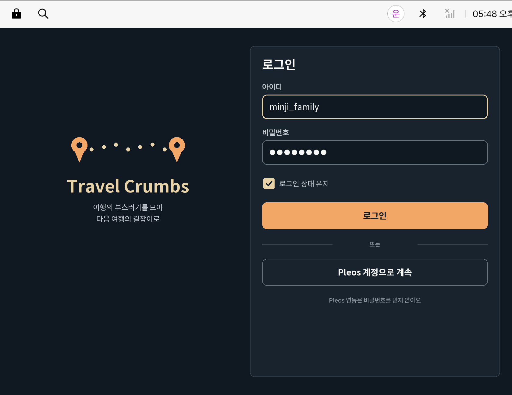

**화면 목적**
- 두 방법 중 편한 쪽으로 로그인하고, 로그인 상태를 유지하면 다음부터는 바로 「기록」 첫 화면

**입력과 조회**
| 구분 | 내용 |
|---|---|
| 사용자 입력 | 아이디 · 비밀번호 · 로그인 상태 유지 · 「Pleos 계정으로 계속」 |
| 자동 입력 | 마지막 로그인 사용자 · 로그인 시각 |
| 화면 조회 | 서비스 이름 · 한 줄 소개 |

**CRUD**
- Read  user_mst (login_id · 비밀번호 확인)
- Create  user_mst (Pleos 처음 연동 · 닉네임 기본값)
- Update  로컬 세션 · 마지막 로그인 시각

**액션 연결**
- 트리거  「로그인」 또는 「Pleos 계정으로 계속」
- 확인  로그인 성공 → C-02 기록 첫 화면
- 다음  닉네임은 C-03 설정에서 바꿈

> 제안 · 자체 계정 비밀번호는 서버에 해시로만 저장  |  ADR 0015 「비밀번호 저장 안 함」(Pleos 로그인 기준)과 맞출 것 · 기보님 확인

---

## C-02 · 기록 · 첫 화면
*로그인 직후 · 진행 중 여행이 없을 때 · 두 시나리오의 분기점*

**공통 · 담당 화면 구조 · 희주 / 데이터 흐름 · LLM반 · 시나리오 S-1 ② · S-2 ②**

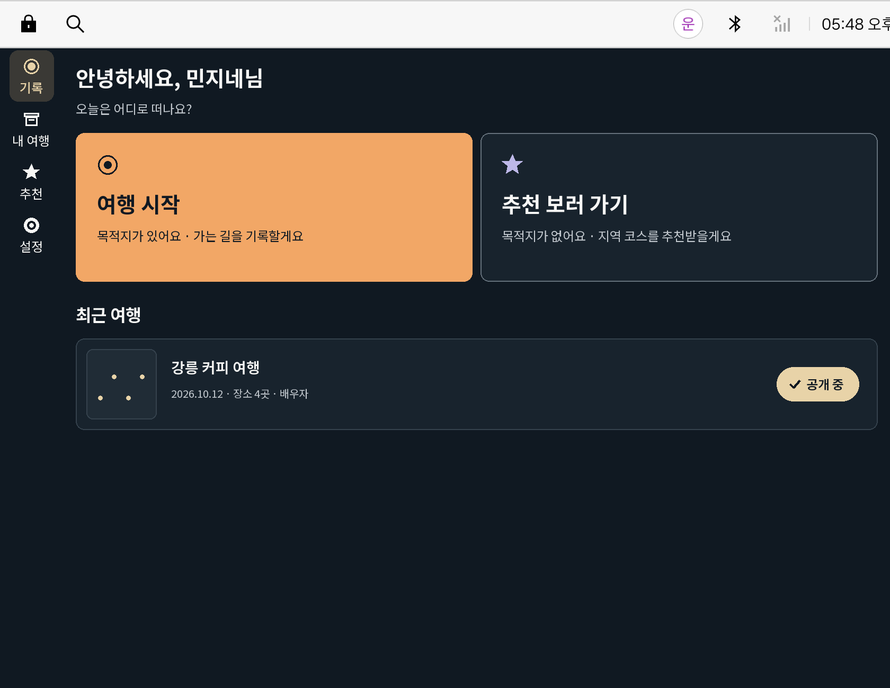

**화면 목적**
- 목적지가 있으면 「여행 시작」, 없으면 「추천 보러 가기」로 한 번에 갈라짐

**입력과 조회**
| 구분 | 내용 |
|---|---|
| 사용자 입력 | 「여행 시작」 · 「추천 보러 가기」 · 최근 여행 카드 |
| 자동 입력 | user_no |
| 화면 조회 | 닉네임 · 최근 여행 1개 · 공개 상태 |

**CRUD**
- Read  user_mst.nickname_nm
- Read  최근 trip_mst 1건 (COMPLETED)
- Read  진행 중 trip_mst 없음 확인

**액션 연결**
- 트리거  로그인 성공 · 레일 「기록」
- 확인  「여행 시작」 → A-01 / 「추천 보러 가기」 → B-01
- 다음  최근 여행 카드 → A-08

---

## A-01 · 여행 시작
*목적지가 있는 사용자 · 여행 이름과 동행자만 정하고 바로 출발*

**시나리오 1 · 목적지 있음 → 기록 · 담당 화면 구조 · 희주 / 데이터 흐름 · LLM반 · 시나리오 S-1 ③**

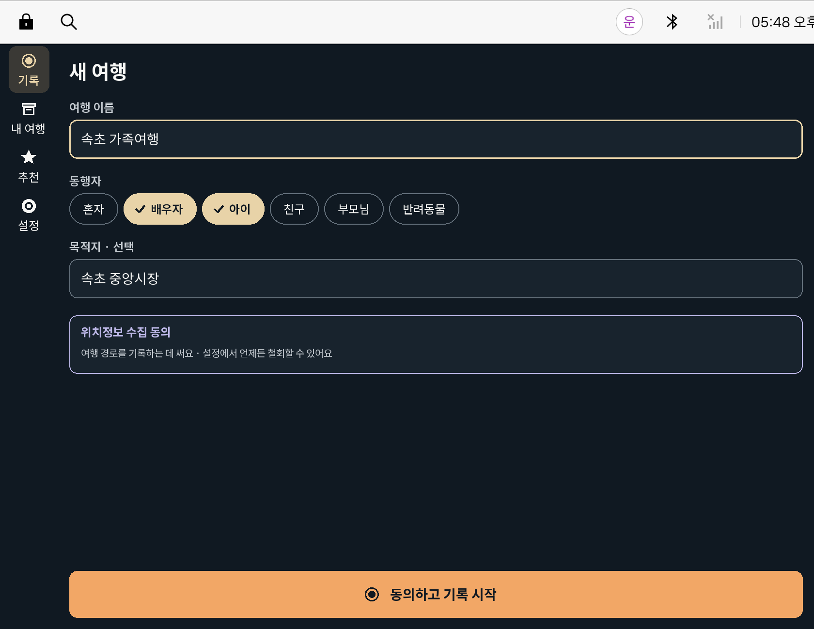

**화면 목적**
- 최소 입력으로 여행을 만들고 기록을 시작 · 위치 동의는 첫 여행에서 한 번만

**입력과 조회**
| 구분 | 내용 |
|---|---|
| 사용자 입력 | 여행명 · 동행자 · 목적지(선택) · 위치 동의 |
| 자동 입력 | user_no · 시작 시각 |
| 화면 조회 | 동행자 유형 · 동의 상태 |

**CRUD**
- Create  trip_mst (RECORDING · PRIVATE)
- Create  trip_companion_dtl
- Create  user_consent_hist (LOCATION_COLLECT · 처음만)

**액션 연결**
- 트리거  C-02 「여행 시작」
- 확인  「기록 시작」 → 기어 D 면 A-02
- 다음  목적지는 차량 내비에 따로 입력

---

## A-02 · 주행 중 기록
*버튼 4개 · 「이 장소 기록」은 위치만 저장하고 태그는 나중에*

**시나리오 1 · 목적지 있음 → 기록 · 담당 화면 구조 · 희주 / 데이터 흐름 · LLM반 / 내비게이션 · 성호 · 시나리오 S-1 ④**

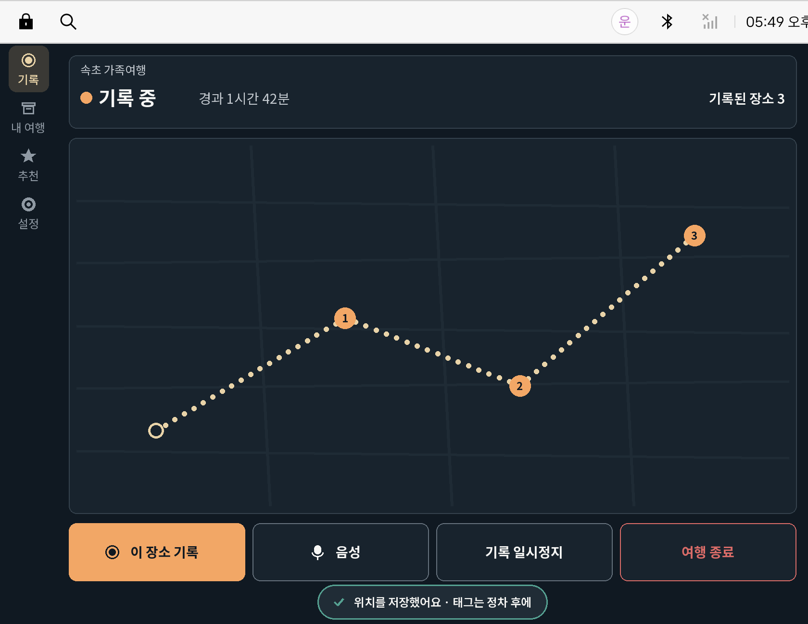

**화면 목적**
- 주행 중엔 한 번 터치로 위치만 임시 저장 · 태그 · 메모 입력은 정차 뒤로 미룸

**입력과 조회**
| 구분 | 내용 |
|---|---|
| 사용자 입력 | 이 장소 기록 · 음성 · 기록 일시정지 · 여행 종료 |
| 자동 입력 | trip_no · 위도 · 경도 · recorded_at |
| 화면 조회 | 여행명 · 상태 · 경과 · 장소 수 |

**CRUD**
- Create  trip_route_point_dtl (거리 · 방향 · 정차)
- Create  trip_place_dtl (draft_yn = Y)
- Update  trip_mst.trip_status_cd (PAUSED)

**액션 연결**
- 트리거  「이 장소 기록」 또는 음성 「여기 기록해 줘」
- 확인  「위치 저장 · 태그는 정차 후」 한 줄 안내
- 다음  정차하면 A-03 태그 시트를 띄울 수 있음

> 조정 · 주행 중 태그 입력 없음  |  이유 · 운전자 주의 분산 최소화 · 태그 안 단 장소는 A-05 에서 모아 처리

---

## A-03 · 장소 기록 · 태그
*정차 중 「이 장소 기록」 · 기록할 때마다 태그 · 메모 · 귀찮으면 건너뛰기*

**시나리오 1 · 목적지 있음 → 기록 · 담당 화면 구조 · 희주 / 데이터 흐름 · LLM반 · 시나리오 S-1 ⑤**

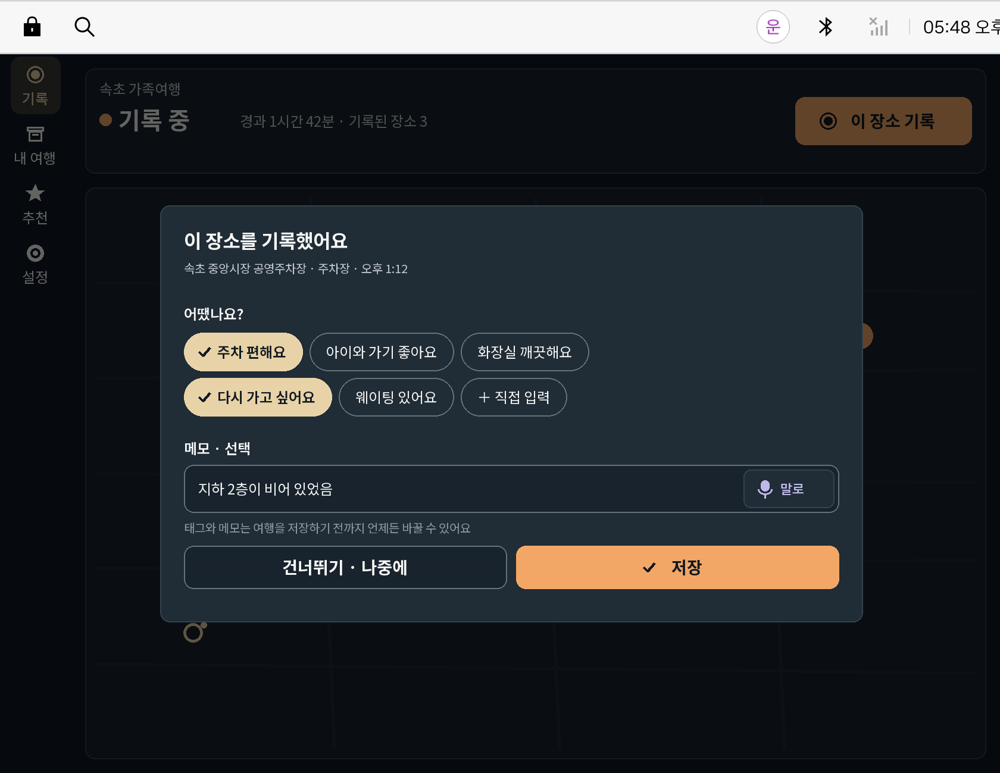

**화면 목적**
- 장소마다 짧은 태그로 경험을 남김 · 건너뛰어도 장소는 저장되고 나중에 채울 수 있음

**입력과 조회**
| 구분 | 내용 |
|---|---|
| 사용자 입력 | 장소 이름 확인 · 태그 선택 · 메모(선택) |
| 자동 입력 | trip_place_no · 위도 · 경도 · 방문 시각 |
| 화면 조회 | 추천 장소 이름 · 장소 유형 · 자주 쓴 태그 |

**CRUD**
- Update  trip_place_dtl (user_place_nm · memo · draft_yn = N)
- Create  trip_place_tag_rel
- Read  tag_mst (use_yn = Y · sort_ord)

**액션 연결**
- 트리거  정차 중 「이 장소 기록」 · 주행 뒤 정차 알림
- 확인  「저장」 → 기록 화면 · 장소 수 +1
- 다음  「건너뛰기」 → draft_yn = Y 로 남김 · A-05 에서 채움

---

## A-04 · 여행 종료 확인
*주행 중 「여행 종료」 · 실수로 끝나지 않게 한 번만 확인*

**시나리오 1 · 목적지 있음 → 기록 · 담당 화면 구조 · 희주 / 데이터 흐름 · LLM반 · 시나리오 S-1 ⑥**

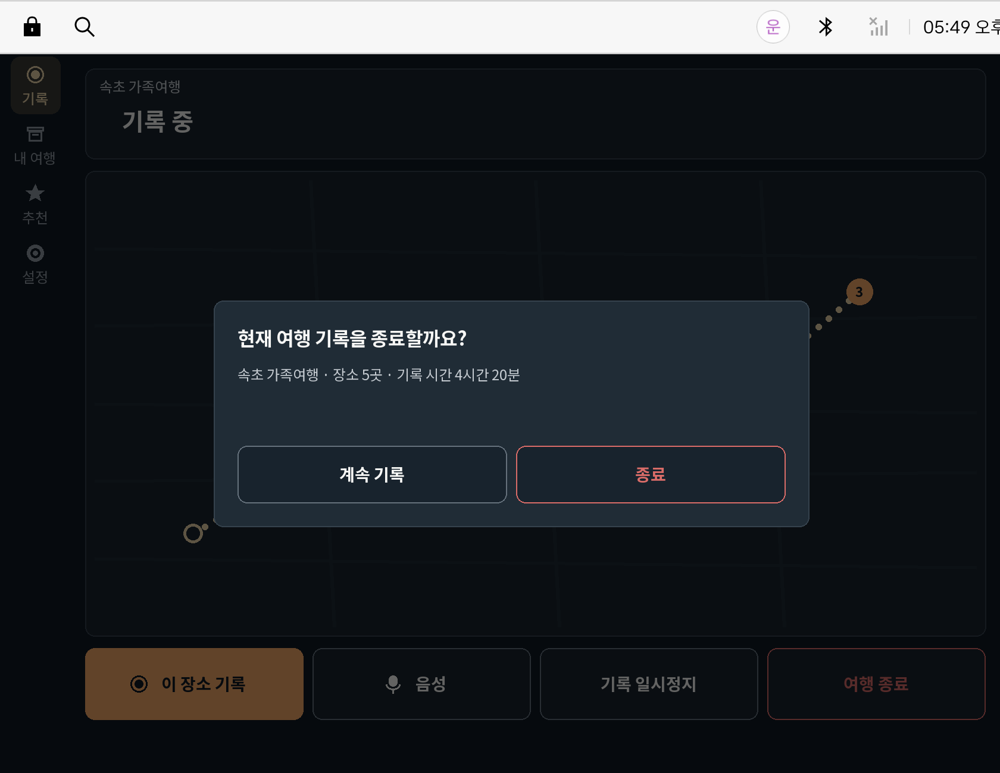

**화면 목적**
- 기록을 끝내기 전 한 번 확인 · 종료하면 바로 로드맵 검토(A-05)로 넘어갈 준비

**입력과 조회**
| 구분 | 내용 |
|---|---|
| 사용자 입력 | 「계속 기록」 · 「종료」 |
| 자동 입력 | 종료 시각 · 기록 시간(일시정지 제외) |
| 화면 조회 | 여행명 · 장소 수 |

**CRUD**
- Update  trip_mst (COMPLETED · end_at · duration)
- Create  trip_status_hist
- Create  trip_route_dtl (간소화 경로)

**액션 연결**
- 트리거  주행 화면 「여행 종료」
- 확인  「종료」 → 정차하면 A-05 로드맵 검토
- 다음  「계속 기록」 → 팝업만 닫힘

---

## A-05 · 로드맵 검토 · 태그 수정
*최종 저장 전 · 경로와 장소 순서를 보고 건너뛴 태그를 채움*

**시나리오 1 · 목적지 있음 → 기록 · 담당 데이터 흐름 · LLM반 / 공유 · 추천 · 희주 · 성호 · 시나리오 S-1 ⑦**

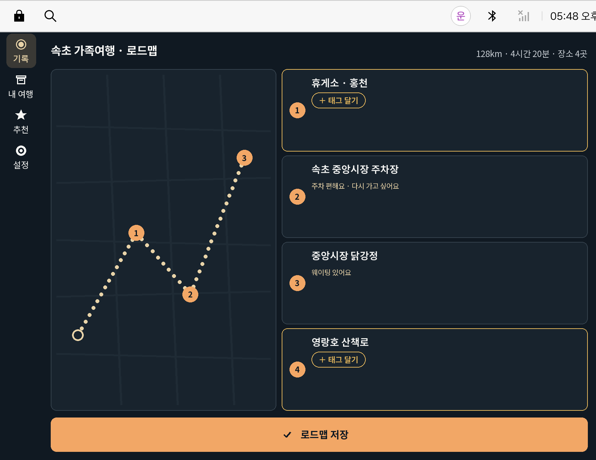

**화면 목적**
- 다녀온 경로 · 장소를 한눈에 보고 태그를 고친 뒤 나만의 로드맵으로 저장

**입력과 조회**
| 구분 | 내용 |
|---|---|
| 사용자 입력 | 장소 태그 수정 · 장소 순서 확인 · 「로드맵 저장」 |
| 자동 입력 | trip_no · place_ord |
| 화면 조회 | 간소화 경로 · 장소 순서 · 태그 · 미완성 표시 |

**CRUD**
- Read  trip_route_dtl · trip_place_dtl (place_ord)
- Update  trip_place_tag_rel · memo
- Update  trip_place_dtl.draft_yn = N

**액션 연결**
- 트리거  여행 종료 뒤 정차
- 확인  「로드맵 저장」 → A-06 공개 설정
- 다음  「태그 달기」 → A-03 시트를 그 장소로 엶

---

## A-06 · 저장 · 공개 설정
*로드맵을 내 여행에 저장 · 공개하면 추천 랭킹에 닉네임으로 보임*

**시나리오 1 · 목적지 있음 → 기록 · 담당 공유 · 추천 · 희주 · 성호 / 데이터 흐름 · LLM반 · 시나리오 S-1 ⑦**

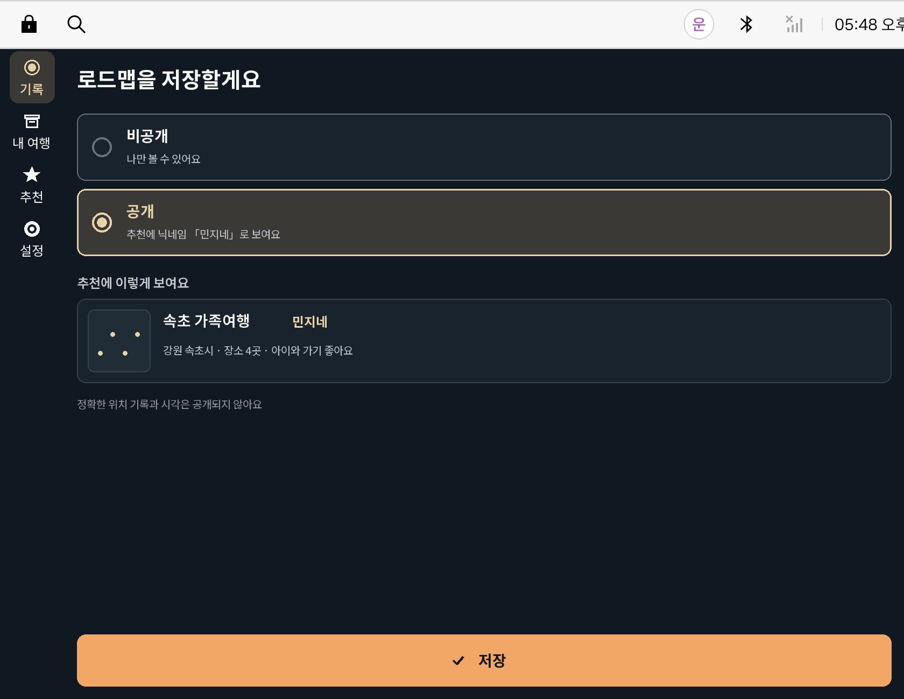

**화면 목적**
- 나만 볼지, 다른 사람에게 추천 로드맵으로 공개할지 정하고 저장

**입력과 조회**
| 구분 | 내용 |
|---|---|
| 사용자 입력 | 비공개 · 공개(닉네임 표시) · 추천 공개 동의 |
| 자동 입력 | trip_no · 닉네임 · 지역(장소에서 계산) |
| 화면 조회 | 공개 미리보기 카드 |

**CRUD**
- Update  trip_mst.visibility_cd
- Create  user_consent_hist (RECO_PUBLIC · 처음만)
- Read  user_mst.nickname_nm

**액션 연결**
- 트리거  A-05 「로드맵 저장」
- 확인  「저장」 → A-07 내 여행 보관함
- 다음  공개 범위는 A-07 · A-08 에서 언제든 바꿈

> 제안 · 공개 범위에 「닉네임 공개」 코드 추가 필요  |  이유 · 표준 VISIBILITY 는 익명 공개만 있음(지수님 확인)

---

## A-07 · 내 여행 · 보관함
*다녀온 여행을 모아 두는 칸 · 여행마다 공개 / 비공개를 바로 바꿈*

**시나리오 1 · 목적지 있음 → 기록 · 담당 공유 · 추천 · 희주 · 성호 / 데이터 흐름 · LLM반 · 시나리오 S-1 ⑧**

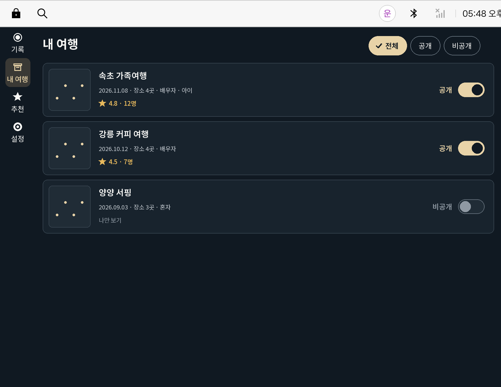

**화면 목적**
- 내가 다녀온 곳을 보관하고, 여행 하나하나의 공개 여부를 목록에서 바로 관리

**입력과 조회**
| 구분 | 내용 |
|---|---|
| 사용자 입력 | 여행 카드 선택 · 공개 토글 |
| 자동 입력 | user_no |
| 화면 조회 | 여행명 · 날짜 · 장소 수 · 동행자 · 공개 상태 · 별점 |

**CRUD**
- Read  trip_mst (user_no · COMPLETED)
- Update  trip_mst.visibility_cd
- Read  trip_place_dtl 장소 수

**액션 연결**
- 트리거  레일 「내 여행」 · A-06 저장 뒤
- 확인  토글 → 공개 / 비공개 즉시 반영
- 다음  카드 → A-08 로드맵 상세

---

## A-08 · 내 로드맵 상세
*보관함에서 연 여행 · 태그 · 메모를 고치고 공개 범위를 바꿈*

**시나리오 1 · 목적지 있음 → 기록 · 담당 공유 · 추천 · 희주 · 성호 / 데이터 흐름 · LLM반 · 시나리오 S-1 ⑧**

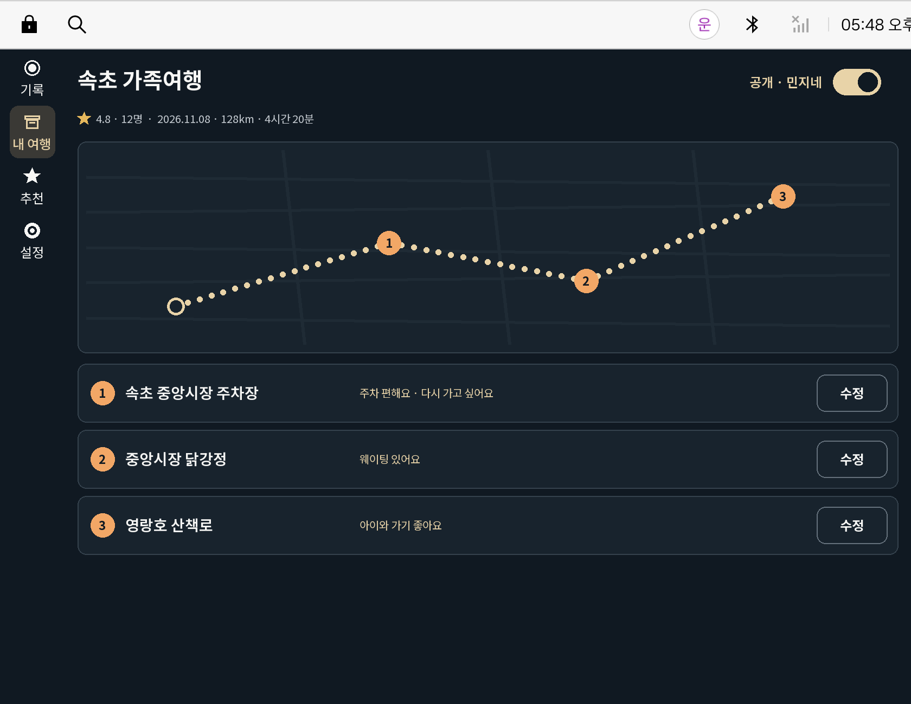

**화면 목적**
- 저장한 로드맵을 다시 보고 다듬음 · 받은 별점도 여기서 확인

**입력과 조회**
| 구분 | 내용 |
|---|---|
| 사용자 입력 | 제목 수정 · 장소 태그 수정 · 공개 토글 |
| 자동 입력 | trip_no |
| 화면 조회 | 경로 · 장소 순서 · 태그 · 별점 평균 · 참여 수 |

**CRUD**
- Read  trip_mst · trip_route_dtl · trip_place_dtl
- Update  trip_nm · trip_place_tag_rel · memo
- Read  로드맵 별점 평균(제안 테이블)

**액션 연결**
- 트리거  A-07 여행 카드
- 확인  고친 내용 즉시 저장
- 다음  공개 중이면 추천 랭킹에 바로 반영

---

## B-01 · 추천 · 지역 고르기
*목적지가 없는 사용자 · 시도 → 시군구 두 번이면 끝*

**시나리오 2 · 목적지 없음 → 추천 · 담당 공유 · 추천 · 희주 · 성호 / 데이터 흐름 · LLM반 · 시나리오 S-2 ③**

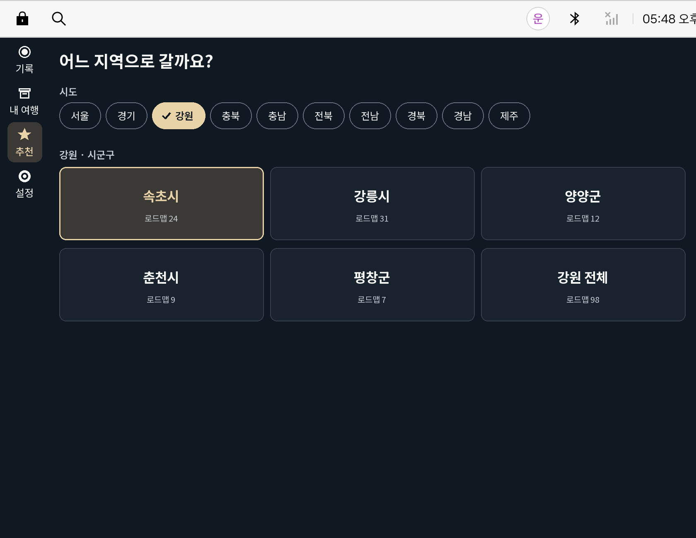

**화면 목적**
- 갈 지역만 고르면 그 지역에서 공개된 로드맵을 별점순으로 보여 줌

**입력과 조회**
| 구분 | 내용 |
|---|---|
| 사용자 입력 | 시도 · 시군구 선택 |
| 자동 입력 | user_no |
| 화면 조회 | 지역별 공개 로드맵 수 |

**CRUD**
- Read  지역 마스터(제안 · 시도 · 시군구)
- Read  공개 trip_mst 지역별 개수

**액션 연결**
- 트리거  C-02 「추천 보러 가기」 · 레일 「추천」
- 확인  시군구 선택 → B-02 랭킹
- 다음  「전체」 고르면 시도 전체 랭킹

> 제안 · 지역 마스터 · place_mst 주소 · 지역 칸 추가  |  이유 · 표준 v0.4 에 지역 단어 · 칸 없음(지수님 확인)

---

## B-02 · 지역 로드맵 랭킹
*강원 속초시 · 다른 여행자가 공개한 로드맵을 별점순으로*

**시나리오 2 · 목적지 없음 → 추천 · 담당 공유 · 추천 · 희주 · 성호 / 데이터 흐름 · LLM반 · 시나리오 S-2 ④**

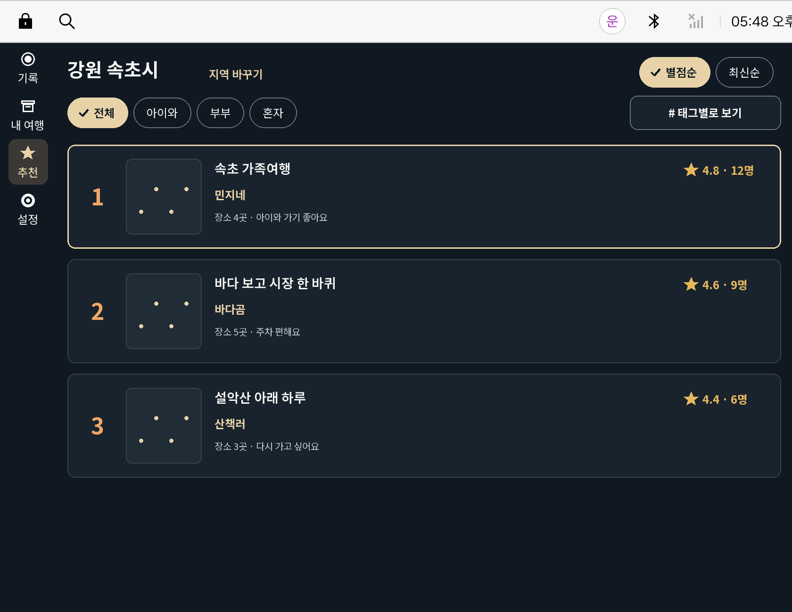

**화면 목적**
- 검증된 코스를 별점 · 참여 수로 고르고 작성자 닉네임으로 믿을 만한지 판단

**입력과 조회**
| 구분 | 내용 |
|---|---|
| 사용자 입력 | 정렬(별점 · 최신) · 동행자 필터 · 로드맵 선택 |
| 자동 입력 | 지역 · user_no |
| 화면 조회 | 순위 · 여행명 · 닉네임 · 별점 · 장소 수 · 대표 태그 |

**CRUD**
- Read  공개 trip_mst (지역 · 닉네임 공개)
- Read  로드맵 별점 평균 · 참여 수(제안)
- Read  trip_place_tag_rel 대표 태그

**액션 연결**
- 트리거  B-01 시군구 선택
- 확인  로드맵 카드 → B-04 상세
- 다음  「태그별로 보기」 → B-03

---

## B-03 · 태그별로 보기
*지역 로드맵에 붙은 태그를 많은 순으로 · 태그를 누르면 그 로드맵만*

**시나리오 2 · 목적지 없음 → 추천 · 담당 공유 · 추천 · 희주 · 성호 / 데이터 흐름 · LLM반 · 시나리오 S-2 ⑤**

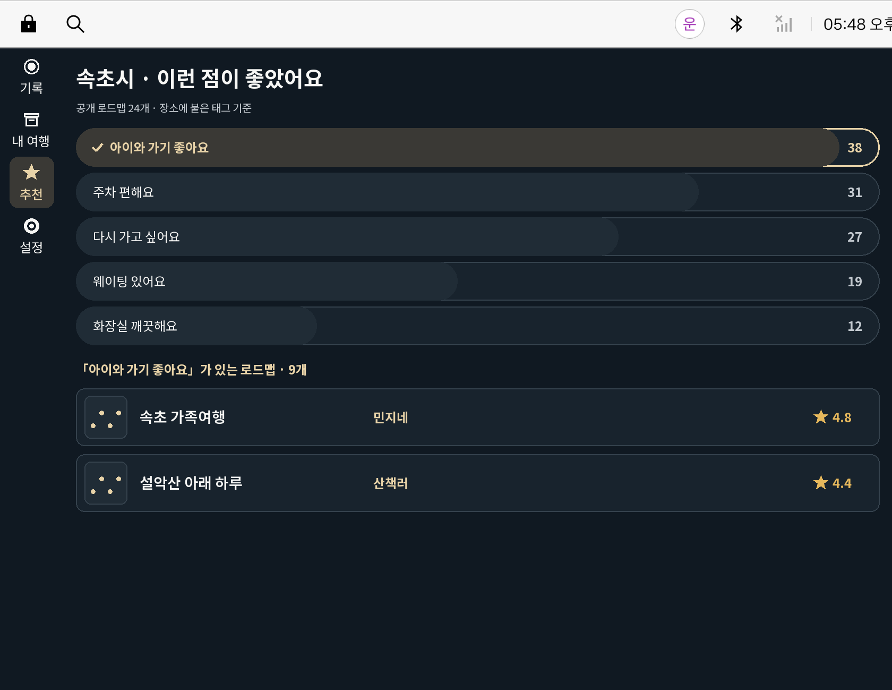

**화면 목적**
- 리뷰 앱처럼 「이런 점이 좋았어요」를 태그 수로 보여 주고, 원하는 경험이 있는 로드맵만 골라 봄

**입력과 조회**
| 구분 | 내용 |
|---|---|
| 사용자 입력 | 태그 선택 · 로드맵 선택 |
| 자동 입력 | 지역 |
| 화면 조회 | 태그별 붙은 수 · 그 태그가 있는 로드맵 |

**CRUD**
- Read  trip_place_tag_rel · tag_mst (지역별 태그 수)
- Read  공개 trip_mst (선택 태그 포함)

**액션 연결**
- 트리거  B-02 「태그별로 보기」
- 확인  태그 → 아래 목록이 그 태그 로드맵으로
- 다음  로드맵 카드 → B-04 상세

---

## B-04 · 추천 로드맵 상세
*장소 순서 · 태그 · 별점을 보고 안내를 시작*

**시나리오 2 · 목적지 없음 → 추천 · 담당 내비게이션 · 성호 / 데이터 흐름 · LLM반 · 시나리오 S-2 ⑥**

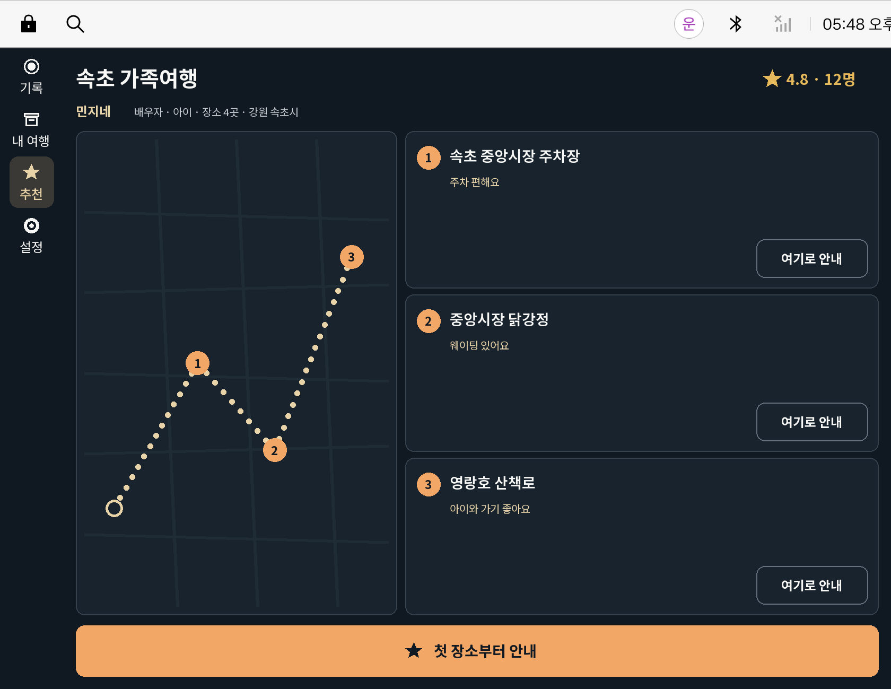

**화면 목적**
- 다른 여행자의 코스를 그대로 따라갈 수 있게 장소 순서와 경험 태그를 보여 줌

**입력과 조회**
| 구분 | 내용 |
|---|---|
| 사용자 입력 | 「첫 장소부터 안내」 · 장소별 「여기로 안내」 |
| 자동 입력 | trip_no · 선택 장소 |
| 화면 조회 | 닉네임 · 경로 · 장소 순서 · 태그 · 별점 |

**CRUD**
- Read  trip_mst · trip_route_dtl (간소화 경로)
- Read  trip_place_dtl · trip_place_tag_rel
- Read  place_mst (장소 이름 · 안내용 좌표)

**액션 연결**
- 트리거  B-02 · B-03 로드맵 카드
- 확인  「첫 장소부터 안내」 → B-05
- 다음  장소 하나만 → 「여기로 안내」 → B-05

> 미정 · 로드맵 전체(경유지 여러 곳) 안내  |  NaviHelper 경유지 지원 실증 뒤 결정(성호) · 지금은 장소 하나씩

---

## B-05 · 안내 시작 → 내비 홈
*확인 한 번이면 차량 내비가 길안내를 넘겨받음*

**시나리오 2 · 목적지 없음 → 추천 · 담당 내비게이션 · 성호 / 데이터 흐름 · LLM반 · 시나리오 S-2 ⑦**

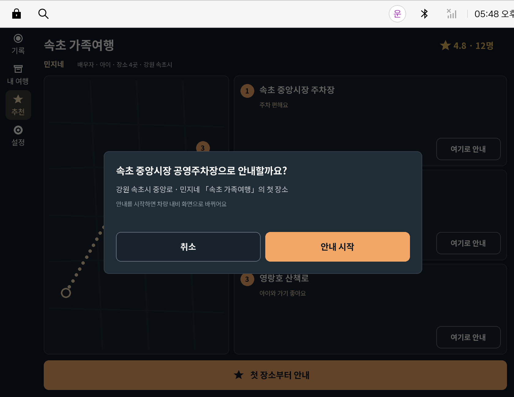

**화면 목적**
- 선택한 장소를 차량 내비 목적지로 넘기고 내비 화면으로 전환

**입력과 조회**
| 구분 | 내용 |
|---|---|
| 사용자 입력 | 「안내 시작」 |
| 자동 입력 | 장소 이름 · 안내용 좌표 · 요청 시각 |
| 화면 조회 | 목적지 이름 · 주소 |

**CRUD**
- Create  navi_req_log (NAVI_REQ_STATUS 요청 → 성공)
- Read  place_mst (안내용 좌표)

**액션 연결**
- 트리거  B-04 「첫 장소부터 안내」
- 확인  NaviHelper requestRoute → 내비 홈 전환
- 다음  여행 종료 뒤 B-06 별점 주기 · 안내만 받으면 상세에서

---

## B-06 · 별점 주기
*추천 로드맵 안내를 받은 여행을 「여행 종료」로 끝내면 정차 뒤 한 번 묻고 별 다섯 개 중 고름*

**시나리오 2 · 목적지 없음 → 추천 · 담당 공유 · 추천 · 희주 · 성호 / 데이터 흐름 · LLM반 · 시나리오 S-2 ⑧**

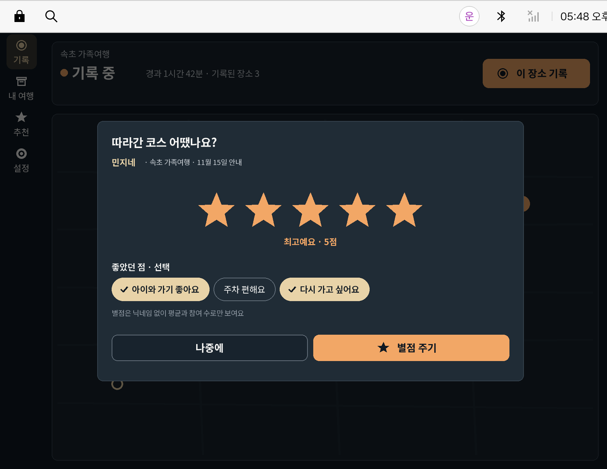

**화면 목적**
- 따라간 코스를 별점과 태그로 평가 · 이 평가가 지역 랭킹(B-02)과 태그별 보기(B-03)의 재료가 됨

**입력과 조회**
| 구분 | 내용 |
|---|---|
| 사용자 입력 | 별점 1~5 · 좋았던 점 태그(선택) · 「별점 주기」 |
| 자동 입력 | user_no · trip_no(따라간 로드맵) · 평가 시각 |
| 화면 조회 | 로드맵 이름 · 작성자 닉네임 · 안내받은 날짜 |

**CRUD**
- Read  navi_req_log (안내받은 로드맵 확인)
- Create  로드맵 별점(제안 · 사용자 한 명 · 여행 하나에 하나)
- Read  tag_mst (좋았던 점 태그)

**액션 연결**
- 트리거  안내 성공 뒤 여행 종료 → 정차 · 로드맵 상세 「별점 주기」
- 확인  「별점 주기」 → 랭킹 평균에 바로 반영
- 다음  「나중에」 → 내 여행 · 로드맵 상세에서 다시

> 제안 · 별점은 안내받은 로드맵에만(navi_req_log 확인)  |  이유 · 다녀오지 않은 사람의 별점으로 랭킹이 흔들리지 않게

---

## C-03 · 설정
*닉네임 · 동의 · 로그아웃 · 공개 로드맵에 보이는 이름을 여기서 정함*

**공통 · 담당 공유 · 추천 · 희주 · 성호 / 데이터 흐름 · LLM반 · 시나리오 S-1 · S-2 공통**

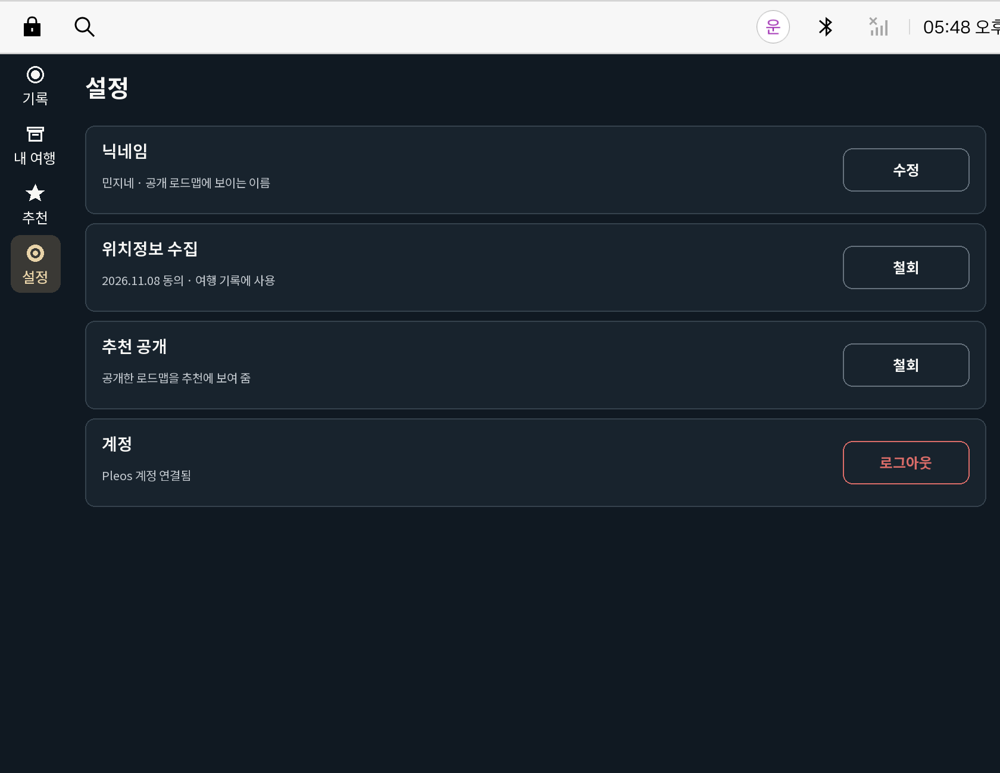

**화면 목적**
- 공개할 때 보일 닉네임과 위치 · 추천 공개 동의를 확인하고 철회

**입력과 조회**
| 구분 | 내용 |
|---|---|
| 사용자 입력 | 닉네임 수정 · 동의 철회 · 로그아웃 |
| 자동 입력 | user_no · 철회 시각 |
| 화면 조회 | 닉네임 · 동의 유형별 최신 상태 |

**CRUD**
- Update  user_mst.nickname_nm
- Read  user_consent_hist 최신 건
- Create  user_consent_hist (철회)

**액션 연결**
- 트리거  레일 「설정」
- 확인  닉네임 저장 → 공개 로드맵 이름 바로 바뀜
- 다음  추천 공개 철회 → 공개 로드맵 모두 비공개

---

## D-01 · 데이터 연결 요약
*v6 화면이 쓰는 테이블 · 새로 필요한 것(제안 · 지수님 확인)*

- 통합본  D-01
- 있는 것 · 데이터 표준 v0.4
- 새로 필요한 것 · 제안
- user_mst · nickname_nm · login_id / user_consent_hist · LOCATION_COLLECT · RECO_PUBLIC / trip_mst · trip_nm · trip_status_cd · visibility_cd / trip_companion_dtl · companion_type_cd / trip_route_point_dtl · trip_route_dtl(간소화 경로) / trip_place_dtl · user_place_nm · memo · draft_yn · place_ord / tag_mst · trip_place_tag_rel(해요체 태그) / place_mst · navi_req_log · NAVI_REQ_STATUS
- VISIBILITY 에 닉네임 공개 코드(예: PUBLIC) — 지금은 ANONYMOUS_PUBLIC 만 / 지역 마스터(시도 · 시군구) · place_mst 에 주소 · 지역 칸 / 로드맵 별점 · 사용자 한 명이 여행 하나에 별점 하나(B-06 · 별점 1~5 · 고른 태그) / 랭킹은 별점 평균 · 참여 수로 그때그때 계산(테이블 없음) / 태그별 보기는 trip_place_tag_rel 을 지역 · 태그로 세어 계산(테이블 없음) / 표준 단어 등록 · 지역 · 시도 · 시군구 · 주소 · 별점 · 순위
- 흐름 · 기록(trip · route · place) → 로드맵 저장(draft_yn = N · 태그) → 공개(visibility_cd) → 추천 랭킹(지역 · 별점) → 안내(navi_req_log)
- 이름은 모두 데이터 표준 규칙(snake_case · 유형 단어 · 공통 컬럼)을 따름 · 「제안」은 표준 등록 전까지 확정 아님

---

## D-02 · 미결 · 다음 단계
*이번 판은 Happy case 만 · 결정이 필요한 것과 담당*

- 통합본  D-02
- 지역을 어디서 얻을지
- 장소 검색 결과 주소 · 좌표 → 주소 변환 · 시연은 시드 데이터
- 지수 · 성호
- 공개 범위 표현
- 닉네임 공개 코드 추가 vs 익명 유지 · 이번 판은 닉네임 표시안
- 희주 · 성호 → 지수
- 「안내 시작」 단위
- 로드맵 전체(경유지) vs 장소 하나 · NaviHelper 경유지 실증
- 성호
- 별점 · 지역 · 랭킹 단어
- 표준 v0.5 에 단어 · 테이블 등록
- 지수
- 별점 자격
- 안내받은 사람만 별점(이번 판) vs 누구나 · 한 사람 한 번 · 고칠 수 있는지
- 희주 · 성호
- 로그인 두 방식
- 자체 아이디 · 비밀번호 + Pleos 연동 · 비밀번호 저장 방식 · 두 계정 연결
- 기보 · 희주
- 다음 판(v7)
- 실패 · 빈 상태 · 권한 거부 · 주행 중 음성으로 태그
- 모두
- 다음 · 팀 리뷰 → 확정한 화면부터 기능 이슈로(공유 · 추천 · 기록 태그)

---
