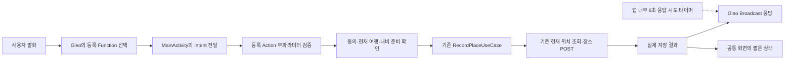

# Gleo로 현재 장소 기록 — 구현 확인 가이드

## 무엇을 만드는가

정차 중 위치 수집에 동의하고 여행을 시작한 사용자가, 이동 중 Gleo에 「이 장소 기록해 줘」라고 말해 위치·시각을 임시 장소로 남기는 기능. 기존 화면의 저장 기능을 그대로 사용하며 새 저장 API·DB·음성 수집 기능 없음.



저장 결과보다 먼저 타이머가 끝나면 완료로 답하지 않음. 응답 후에도 실제 작업 종료까지 음성 재실행 제한 유지. 타이머는 서버 작업 취소나 롤백을 의미하지 않음.

## Android Studio에서 열기

1. 이 저장소를 Android Studio에서 열고 `gleo-ai/impl` 선택. 사람의 다른 작업 체크아웃에서 전환하기 전에는 그 체크아웃의 미커밋 변경 확인.
2. 프로젝트 기존 설정 그대로 Gradle 동기화: compileSdk 36.1, Build Tools 36.0.0, Vehicle 2.3.2, NaviHelper 3.0.5. 새로운 라이브러리 버전을 임의로 올리지 않음.
3. JDK·SDK·Pleos AVD는 [기존 환경 안내](../setup.md)대로 준비. 이번 작업 환경에서는 미확인.
4. PowerShell에서 `python -X utf8 .claude/skills/sensors/scripts/doctor.py` 실행.
5. `gradlew.bat lint testDebugUnitTest assembleRelease` 실행. 시험 결과와 APK는 Gradle 결과로 확인하며 문서의 계획을 통과로 간주하지 않음.
6. 서버는 기존 `server/` 설정과 마이그레이션 사용. debug 앱의 주소는 기존 `10.0.2.2:4000` 유지. release의 `api.invalid`는 배포 서버 주소가 아니므로 이 브랜치만으로 운영 배포 가능하다고 간주하지 않음.

## 시연과 확인

1. Pleos 기기/에뮬레이터에 debug APK 설치. 정차 중 기존 화면에서 위치 동의·여행 시작 완료. 내비 준비까지 확인.
2. 기존 스키마 등록 절차에 따라 `app/src/main/assets/schema.json`의 두 Function 활성화 확인. APK에 스키마가 있다는 사실만으로 Gleo 서버에서 등록됐다고 간주하지 않음.
3. Gleo에 「이 장소 기록해 줘」 발화. 앱에 처리 상태가 표시되고, 서버 저장 응답 뒤에만 완료 안내되는지 확인.
4. 기존 장소 수·임시 기록 목록에 저장됐는지 확인. PAUSED에서도 장소 기록이 가능하되 경로점 자동 수집이 재개되지 않는지 확인.
5. 실패·지연 시 정차 후 기존 기록을 조회. 안내가 미확인일 때 곧바로 다시 기록하도록 유도하지 않음.

Gleo 등록 없이 앱 Intent 경계만 점검하는 명령. 아래 호출은 실제 음성 인식 시험과 구분.

```powershell
adb shell am start -W -n com.example.travelcrumbs/.MainActivity -a RECORD_CURRENT_PLACE --es ACTION_PARAM '{}'
```

## 이번 구현의 경계

- 앱 초기 실행에서 여행 복원이 끝나지 않았으면 준비 미확인 응답. 초기 null을 여행 없음으로 단정하지 않음.
- 앱 내부 6초는 응답 시도 목표. 공식 Gleo 7초 제한을 기기 전체에서 지킨다는 성능 보장 없음.
- 같은 프로세스에서 진행 중인 음성 기록의 중복을 제한. 요청 ID 없는 서로 다른 동시 명령, 수동 기록 버튼과의 동시 실행, 프로세스 종료 후 재전달까지의 완전한 중복 방지 보장 없음.
- 추가 위치 조회·POST는 Gleo 동의 확인 뒤 기존 UseCase에서만 수행. 기존 RouteRecorder 전체의 동의 동작을 이 기능이 보장하지 않음.
- 외부 호출 보호는 출시 전 확인 조건. 현재 exported Activity의 Action·빈 파라미터 검증은 발신자 인증이 아니어서 다른 앱도 같은 입력으로 저장 경로를 호출할 수 있음. 공식 Gleo 보호 계약을 확인하고 별도 UID 앱의 무권한 저장 차단을 기기에서 검증하기 전에는 출시 승인으로 취급하지 않음. 계약 확보가 불가하면 자동저장 공개 범위 결정 또는 활성화 보류 필요. 임의 package·referrer·extra 비교로 인증을 구현했다고 표시하지 않음. 일반 `startActivity()`에서 `getCallingPackage()`가 null인 제약은 [Android Activity 문서](https://developer.android.com/reference/android/app/Activity#getCallingPackage()) 참조.
- 스펙 PR #26 미머지 상태의 선행 구현. 기준/화면 PR #23 사이 기존 충돌, 하네스 정합성, OpenAPI 생성 기반, 실제 Gleo 등록·실기 시험은 별도 확인 필요.

공식 계약: [App Schema](https://document.pleos.ai/docs/pleos-only/app-integration-guide/guide/app-capability), [Callback](https://document.pleos.ai/docs/pleos-only/app-integration-guide/guide/action_callback), [Intent·Broadcast 예제](https://document.pleos.ai/docs/pleos-only/app-integration-guide/guide/examples), [스키마 등록](https://document.pleos.ai/docs/pleos-only/app-integration-guide/guide/deliver-schema).
