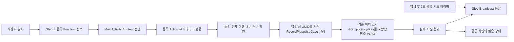

# Gleo로 현재 장소 기록 — 구현 확인 가이드

## 무엇을 만드는가

정차 중 위치 수집에 동의하고 여행을 시작한 사용자가, 이동 중 Gleo에 「이 장소 기록해 줘」라고 말해 위치·시각을 임시 장소로 남기는 기능. 기존 장소 저장 경로에 Gleo 요청 ID를 전달해 서버에서 같은 저장의 재전송을 식별. 배포 빌드의 Gleo 장소 기록은 R1 확인 전까지 비활성.



준비가 끝나기 전에 타이머가 끝나면 대기 중인 명령을 종료함. 이미 저장을 시작했다면 결과 미확인으로 답하고 기존 작업이 끝날 때까지 중복 음성 명령을 제한함.

## Android Studio에서 열기

1. 이 저장소를 Android Studio에서 열고 `gleo-ai/impl` 선택. 사람의 다른 작업 체크아웃에서 전환하기 전에는 그 체크아웃의 미커밋 변경 확인.
2. 프로젝트 기존 설정 그대로 Gradle 동기화: compileSdk 36.1, Build Tools 36.0.0, Vehicle 2.3.2, NaviHelper 3.0.5. 새로운 라이브러리 버전을 임의로 올리지 않음.
3. JDK·SDK·Pleos AVD는 [기존 환경 안내](../setup.md)대로 준비. 이번 작업 환경에서는 미확인.
4. PowerShell에서 `python -X utf8 .claude/skills/sensors/scripts/doctor.py` 실행.
5. `gradlew.bat lint testDebugUnitTest assembleRelease` 실행. 시험 결과와 APK는 Gradle 결과로 확인하며 문서의 계획을 통과로 간주하지 않음.
6. 서버는 기존 `server/` 설정과 마이그레이션 사용. debug 앱의 주소는 기존 `10.0.2.2:4000` 유지. release의 `api.invalid`는 배포 서버 주소가 아니므로 이 브랜치만으로 운영 배포 가능하다고 간주하지 않음.

## 시연과 확인

1. Pleos 기기/에뮬레이터에 debug APK 설치. 정차 중 기존 화면에서 위치 동의·여행 시작 완료. 내비 준비까지 확인.
2. 기존 스키마 등록 절차에 따라 debug용 `app/src/debug/assets/schema.json`의 두 Function 활성화 확인. 배포용 `app/src/main/assets/schema.json`은 OPEN만 선언.
3. Gleo에 「이 장소 기록해 줘」 발화. 앱에 처리 상태가 표시되고, 서버 저장 응답 뒤에만 완료 안내되는지 확인.
4. 기존 장소 수·임시 기록 목록에 저장됐는지 확인. PAUSED에서도 장소 기록이 가능하되 경로점 자동 수집이 재개되지 않는지 확인.
5. 실패·지연 시 정차 후 기존 기록을 조회. 안내가 미확인일 때 곧바로 다시 기록하도록 유도하지 않음.

Gleo 등록 없이 앱 Intent 경계만 점검하는 명령. 아래 호출은 실제 음성 인식 시험과 구분.

```powershell
adb shell am start -W -n com.example.travelcrumbs/.MainActivity -a RECORD_CURRENT_PLACE --es ACTION_PARAM '{}'
```

## 기존 일시정지 복원의 최소 보완

첫 CI가 기존 `TripPauseSyncTest`의 PAUSED 복원 시험에서 실패해 `TripPauseSync`와 해당 시험만 추가 보완. 기존 API·DB·저장 UseCase·일시정지 규칙을 유지하면서 서버→로컬 초기 정렬이 끝난 뒤 로컬→서버 변경 감지를 시작하도록 순서화. 여행이 바뀌면 이전 여행의 초기 대기와 변경 감지를 취소.

기존 시험의 기대값을 유지하고 PAUSED 서버 상태 유지·빠른 여행 전환을 검증. 이 보완은 Gleo 입력 연결 외의 최소 의존 수정이므로 리뷰에서 함께 확인할 대상.

## 승인된 구현 기준

- U1. 위치 조회 실패나 확인된 HTTP 거절은 「장소 기록에 실패했어요」로 안내. 응답 유실·저장 기한 초과에는 결과 미확인 안내 적용. 입력·동의·준비 조건의 기존 안내 유지.
- U2. 앱의 Action 수신부터 7초 이내 응답 시도. 준비가 늦으면 대기만 끝내고 저장을 시작하지 않음. 저장을 시작한 경우 실제 작업 종료까지 중복 진입 제한. 앱의 경과와 Gleo 전체 왕복은 실기에서 따로 측정.
- U3. 시작 복원 중 정차 화면에는 진행 표시와 「여행 정보를 불러오고 있어요. 잠시만 기다려 주세요.」, 주행·UNKNOWN에는 「여행 정보를 불러오는 중이에요」 정적 한 줄 표시. 기존 시작 복원과 내비·동의가 기한 안에 확인되면 같은 명령을 이어서 처리.
- 시작 복원·동의 조회 자체가 실패하면 결과 미확인으로 처리. 조회가 끝난 뒤 확인된 여행 부재나 미동의는 해당 준비 안내 적용.
- 준비를 통과한 Gleo 명령마다 앱이 UUID를 한 번 발급해 기존 장소 POST의 `Idempotency-Key`에 전달. 발급 실패 시 해당 장소 POST 차단. 수동 기록은 헤더 생략. 키가 있는 요청의 전송 후 OkHttp 자동 재전송은 one-shot 본문으로 제한.
- 같은 여행의 장소 추가 응답이 뒤늦게 도착해도 이미 화면에 반영된 장소 수를 줄이지 않음.
- Gleo 키가 있는 장소 POST는 앱의 BASIC 요청 로그에서 제외. 기존 서버 접근 로그는 서버 운영 설정 범위.
- 앱 발급 키의 범위는 같은 저장 요청. 새로 들어온 Gleo Action 두 건의 연관성은 공개 플랫폼 요청 ID 계약 확인 대상.
- Gleo 명령의 추가 위치 조회·POST는 동의 확인 뒤 기존 UseCase에서 수행. 기존 RouteRecorder 동의 동작은 스펙 D5의 별도 의존 조건.
- 배포 빌드는 RECORD를 준비 조회 전에 차단하고 관련 Action 필터와 스키마 항목을 제외. debug 빌드는 격리된 시연 환경에서 OPEN과 RECORD 시험에 사용. 공개 활성화는 공식 Gleo 호출 보호 계약과 별도 UID 앱의 무권한 호출 시험 이후 검토.
- 기준은 병합된 스펙 PR #26. 실제 Gleo 등록·기기 시험과 하네스의 OpenAPI 생성 기반은 별도 확인 항목.

공식 계약: [App Schema](https://document.pleos.ai/docs/pleos-only/app-integration-guide/guide/app-capability), [Callback](https://document.pleos.ai/docs/pleos-only/app-integration-guide/guide/action_callback), [Intent·Broadcast 예제](https://document.pleos.ai/docs/pleos-only/app-integration-guide/guide/examples), [스키마 등록](https://document.pleos.ai/docs/pleos-only/app-integration-guide/guide/deliver-schema).

## 검증 결과

제품 소스 `1629dc8` + `99ed167` 기준 [원격 CI](https://github.com/KANT-HYUNDAI-MOTOR-VEHICLE-APP/travel-crumbs/actions/runs/42476286765)에서 Lint·단위 시험(신규28개 포함)·release 빌드 성공. 두 관점의 2회 정적 리뷰 완료. 외부 호출 보호 확인 1건과 실제 Gleo·기기·DB 시험은 위 경계대로 유지.

검토 브랜치와 최신 검사: [Draft PR #27](https://github.com/KANT-HYUNDAI-MOTOR-VEHICLE-APP/travel-crumbs/pull/27). 자동 머지·배포 없음.
