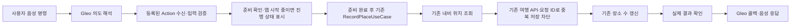

- 이슈: #25 — Gleo Action과 기존 여행 CRUD 연결 기반 — 장소 기록
- 기획: `docs/data/handoff.md` · `docs/data/gleo-handoff.md` · `docs/design/design-system.md` · `데이터표준정의서_v0.4.md` · `docs/data/data-decision-log.md`

# Gleo로 남기는 여행 흔적 — CRUD 연결 기반 스펙

PR #26 리뷰 반영본 및 PR #27 요청 ID 반영안 · 2026-11-10 · 기준 `gleo-ai/main`의 `6281cdb4693224a9338743231070b1b9f03706da`

## 1. 요약

- 대상·상황: 정차 중 위치 동의와 여행 시작을 마친 뒤, 이동 중 지금 지나가는 곳을 남기려는 Travel Crumbs 사용자.
- 핵심 경험: Gleo에 「이 장소 기록해 줘」 한마디 → 기존 장소 기록과 동일한 임시 저장 → 저장 확인 후 음성 결과.
- 이번 범위: 기존 앱 열기 유지 + 장소 기록 1개 연결 + 이후 CRUD 연결에 공통으로 사용할 수신·검증·결과 계약의 정의. 이번 수정은 PR #26의 U1~U3 리뷰 결정을 유지하며, PR #27에서 요청한 장소 저장 요청 ID 계약을 구현 전 검토 범위에 추가.

### 1.1 기능 흐름

(수정: 준비 확인과 기존 업무의 실행 순서 명료화)



기존 장소 기록 진입점에 음성 명령을 연결하는 계약. Action 검증·업무 연결·결과 콜백에 더해, 같은 장소 저장 요청 ID의 중복 커밋을 기존 POST에서 차단. 내비 조회·저장·장소 수 갱신은 기존 CRUD의 책임.

### 1.2 실행 현실성 판정

(수정: U1~U3 리뷰 선택과 실기 확인 범위 반영)

| 항목 | 확인한 근거 | 판정 |
|---|---|---|
| Gleo로 앱 열기 | 기존 `OPEN_TRAVEL_CRUMBS`·Intent 수신·Broadcast 응답 | 유지 대상. 본 세션의 재실행 검증 없음 |
| 준비된 여행에서 장소 기록 | 기존 `TripRecordPlaceUseCase` → 내비 현재 위치 → `TripRepository.recordPlace` | 기존 업무와 POST 경로 재사용, 요청 ID 계약만 확장 |
| 저장 성공 판단 | 서버 `record_place`의 commit 후 응답, 앱의 `ActionResult.DONE` | 응답 확인 후 성공 표현 가능 |
| 일반 실패 안내 | 기존 반환값은 `DONE`·`FAILED`·`NOT_READY` | 위치·서버 오류는 원인 추정 없이 일반 실패로 안내(U1) |
| 7초 안 콜백 | 공식 Gleo 제한 7초, 기존 SDK 대기 최대 10초·HTTP 연결/읽기 각 20초 | 앱 응답 시도에 7초 기한 적용. Gleo 전체 왕복은 실기 확인(U2) |
| 앱을 새로 켠 직후 기록 | `RouteRecorder.start()`의 여행 복원이 비동기이며 Gleo 수신은 즉시 진행 | 복원 중에는 진행 표시와 대기 안내, 기한 안에 준비되면 기존 명령 처리(U3) |
| 동의 확인 | 기존 동의 API 존재, 장소 기록 UseCase 자체에는 동의 검사 없음 | 위치 동의 확인 뒤 이번 명령의 위치 조회·저장 시작(U3) |
| 앱 → 장소 저장 API 재전송 | 기존 POST가 요청 ID를 처리하지 않는 상태 | 유효한 요청 ID를 붙이고, 같은 ID·본문의 동시/순차 전송에도 저장 한 번을 보장하도록 확장하는 구현 조건 |
| Gleo → 앱 Action 재전달 | 공개 Action 계약에서 같은 호출의 ID 유지 보장 미확인 | 진행 중 제한 유지. 앱이 새로 만든 ID만으로 별개 Action 수신 간 재전달 식별 불가. D2 참조 |

**판정: 기존 CRUD 재사용과 U1~U3 리뷰 결정을 유지하고 장소 저장 API의 요청 ID를 구현 필수 조건으로 추가.** 실제 Gleo 왕복·기한·호출 보호와 서버 중복 방지 검증은 6절 시험 계획에 포함.

### 1.3 기존 CRUD 보호 범위

| 기존 기능·규칙 | 이번 계약 |
|---|---|
| 위치 동의 → 여행 시작 | 정차 중 기존 화면 사용. Gleo가 동의나 여행 시작을 대신 처리하지 않음 |
| `RecordPlaceUseCase` 및 실제 바인딩 `TripRecordPlaceUseCase` | 장소 저장의 유일한 기존 업무 경로로 재사용 |
| `TripRepository`·`server/app/trips/`·기존 DTO | 기존 POST 경로·본문·응답 형태 및 헤더 없는 수동 기록 유지. 요청 ID 헤더·서버 중복 방지 상태만 추가 |
| D18 임시 장소 | 위치·시각만 기록하고 `draft_yn = Y` 유지. 이름·후기 자동 생성 없음 |
| D19 공식 장소 | 임시 기록만으로 `place_mst` 생성 또는 공식 장소 연결 없음 |
| D27 일시정지 | `PAUSED`에서도 장소 기록 가능. 경로점 자동 저장 재개와 별개 |
| 날짜 기본 여행명·제목 수정 | 현재 동작 유지. `TripNameSuggester` 교체 없음 |
| 주행 화면의 「음성 입력」 | `StartVoiceInputUseCase`의 준비 중 상태 유지. 이 버튼이 Gleo 청취를 시작한다고 설명하지 않음 |

여행 시작·종료·일시정지·재개·제목 변경은 기존 저장 기능이 있으나 이번 음성 공개 범위 밖. 과거 여행 의미 검색·선택 문맥·내비 목적지 설정은 추가 기능이 필요한 후속 범위. 마이크 SDK·자체 STT/TTS·키워드 분류기·웨이크워드·일반 LLM 호출 제외.

## 2. 화면

### 2.1 기존 여행 기록 홈(A-03·A-05)

(수정: 여행 복원 진행 표시와 일반 실패 문구 반영)

- 기존 여행 상태·장소 수·경로 그림·버튼 구성 재사용. 별도 Gleo 대화 화면 추가 없음.
- Gleo Action의 처리 결과는 짧은 상태 표시 한 곳으로 노출하는 설계안. 실제 상태 제공 위치는 D1의 최소 변경 범위 확인 대상.
- 장소 수는 기존 `activeTrip.placeCount`를 사용하며 Gleo가 화면 숫자를 임의로 증가시키지 않는 원칙.
- 서버 저장이 확인되어도 경로 그림·임시 기록 목록의 재조회가 늦거나 실패할 가능성의 구분. 그림이 바로 바뀌지 않았다는 이유로 재저장 금지.

| 상태 | 정차(PARKED) | 주행(DRIVING) | 모름(UNKNOWN) |
|---|---|---|---|
| 정상 표시 | 기존 홈과 짧은 결과 문구 | 기존 주행 전용 화면의 결과만 | 주행과 동일 |
| 여행 복원 중 | 진행률을 특정하지 않는 진행 표시와 「여행 정보를 불러오고 있어요. 잠시만 기다려 주세요.」 | 기존 주행 화면에 정적인 진행 안내 한 줄 「여행 정보를 불러오는 중이에요」 | 주행과 동일 |
| 준비 중 | 「기록할 준비를 확인하고 있어요」 | 같은 한 줄, 입력 창 없음 | 주행과 동일 |
| 처리 중 | 「이 장소 기록 중」 | 같은 한 줄 | 주행과 동일 |
| 저장 확인 | 「이 장소를 기록했어요」, 기존 장소 수 갱신 | 같은 한 줄, 상세 화면 전환 없음 | 주행과 동일 |
| 사전 조건 미충족 | 「정차 후 여행 기록을 시작해 주세요」 또는 「위치 동의를 확인해 주세요」 | 같은 짧은 안내만, 동의·설정 창 자동 노출 없음 | 주행과 동일 |
| 위치·서버 오류로 명령 실패 | 「장소 기록에 실패했어요」 | 같은 한 줄 | 주행과 동일 |
| 결과 미확인 | 「기록 여부를 확인하지 못했어요. 정차 후 확인해 주세요」 | 같은 한 줄, 즉시 재시도 유도 없음 | 주행과 동일 |

여행 복원 진행은 기존 상태 표시 영역에 표시. 사전 조건 문구는 해당 조건을 실제 확인한 경우에만 사용. 일반 실패 문구는 명령 처리 결과만 전달. 저장 요청의 처리 여부가 불명확한 경우에는 결과 미확인 문구 적용.

### 2.2 기존 주행 전용 화면

- 기록 상태·분 단위 경과·장소 기록·음성 입력·일시정지의 기존 구성 유지.
- R1의 호출 보호 검증이 끝난 환경에서 음성만으로 진입하는 목표. 짧은 결과 안내 외 상세 입력 없음.
- 정차로 바뀌면 기존 앱의 홈 표시 규칙 적용. 주행·UNKNOWN으로 바뀌면 정차 전용 입력 화면 숨김.
- 「듣는 중」·음성 인식 원문·Gleo 내부 실패 횟수는 앱이 수신한다고 확인되지 않은 상태이므로 신규 표시 없음. 디자인 시스템 19장의 전체 음성 상태 구현과 이번 Action 연결 범위의 차이는 D1 기록.
- 음성 결과는 Gleo 콜백으로 요청하며 앱 자체 TTS 중복 재생 없음. Gleo의 실제 한국어 응답 문장은 플랫폼 생성 결과이므로 앱의 고정 멘트와 일치 보장 없음.

## 3. 상태

### 3.1 개념 상태 계약

(수정: 여행 복원 중을 별도 진행 상태로 구분)

아래 칸은 새 DB 모델이 아닌 앱 내 명령 처리와 화면 표시의 개념 계약. 기존 홈·주행 `UiState`를 대체하지 않고, 불변 화면 상태로 표현하는 원칙.

| 칸 | 값 | 의미 |
|---|---|---|
| `functionName` | OPEN / RECORD / 없음 | 수신한 등록 Function |
| `phase` | IDLE·RESTORING_TRIP·PREPARING·PROCESSING·SAVED·FAILED·UNCONFIRMED | 앱이 실제 관측한 처리 단계 |
| `readiness` | UNKNOWN·READY·UNAVAILABLE | 여행·동의·내비가 확인된 준비 상태. 초기 null과 확인된 부재의 구분 |
| `resultReason` | 입력 오류·준비 미확인·확인된 사전 조건·일반 실패·시간 초과·없음 | 실제로 구분 가능한 이유만 사용 |
| `callbackSent` | 참/거짓 | 해당 처리 흐름에서 응답을 이미 보냈는지의 내부 상태. 서버 저장 여부와 별개 |
| 장소 저장 요청 ID | 앱에서 발급한 무작위 UUID / 없음 | 같은 저장 요청을 식별하는 앱·서버 간 값. UI 표시와 Gleo 콜백 대상에서 제외 |
| `message` | 짧은 표시 문구 / 없음 | 화면이 표시하고 확인 후 지우는 상태 |

`tripUuid`·장소 수·동의 원본은 기존 저장소에서 조회하는 값으로, Gleo 전용의 별도 여행 원본 저장 없음. UI에서 자료원 직접 호출·별도 이벤트 Flow·Context 보유 없음. 근거: 저장소 Android 구조 규칙 및 [Google 아키텍처 권장안](https://developer.android.com/topic/architecture/recommendations).

### 3.2 정상 전이

(수정: 앱 시작 직후 명령의 대기와 종료 조건 반영)

1. IDLE → 등록 Action 검증. 미등록 Action은 업무·콜백 실행 없이 기존 무시 원칙 적용.
2. OPEN → 기존 앱 열기 결과 응답. 장소 저장 실행 없음.
3. RECORD 수신 시 여행 복원 중이면 RESTORING_TRIP에서 기존 복원 결과를 기다리고, 그 외에는 PREPARING에서 준비 상태 확인.
4. 기한 안에 위치 동의·현재 여행·내비 준비가 확인되면 같은 명령을 PROCESSING으로 전환. 확인된 사전 조건 미충족이면 FAILED, 조회 오류나 기한 초과로 준비를 확인하지 못하면 UNCONFIRMED. 복원 중의 빈 여행 값은 준비 대기로 처리.
5. PROCESSING → 장소 저장 요청 ID와 함께 기존 `RecordPlaceUseCase` 1회 호출 → 저장 또는 같은 요청의 저장 결과가 확인되면 SAVED, 실패면 확인 가능한 수준의 FAILED/UNCONFIRMED.
6. 마지막 결과의 콜백 1회 전송 시도. 화면 표시 해제는 업무 재실행의 계기가 아님.

‘콜백 1회’는 앱 내부 한 처리 흐름의 목표. 프로세스 종료·플랫폼 재전달까지 포함한 전역 exactly-once 보장과 구별.

### 3.3 시간·취소·늦은 결과

(수정: 내부 7초 기한과 준비 대기·기존 업무 종료의 분리)

- 공식 한도: Gleo가 7초 뒤 Action을 취소하는 규칙. 근거: [Callback Schema 가이드](https://document.pleos.ai/docs/pleos-only/app-integration-guide/guide/action_callback).
- 현재 대기: `SDK_CALL_TIMEOUT_MS = 10,000ms`, OkHttp 연결·읽기 각각 20초. 기존 수치를 전역으로 줄여 다른 CRUD에 영향을 주는 변경 금지.
- 앱 기준은 Action 수신부터 **7초**. 준비 확인과 기존 기록 동작을 같은 기한 안에서 관리하고, 결과가 확인되면 즉시 콜백 전송 시도. Gleo의 타이머는 앱 수신보다 먼저 시작할 수 있으므로 앱 내부 경과와 Gleo 전체 경과는 실기에서 각각 측정.
- 7초까지 준비를 마치지 못한 명령은 준비 대기를 끝내고 결과 미확인 fail 전송 시도. 뒤늦게 준비돼도 해당 명령으로 기록 시작 금지.
- 기존 기록 동작을 시작한 뒤 기한까지 저장을 확인하지 못하면 결과 미확인 fail 전송 시도. 기한 경계에서 시도한 콜백의 Gleo 수신 여부는 실기 확인 대상.
- 코루틴/HTTP 취소는 서버 트랜잭션 롤백 증명이 아님. 기존 코드의 `runCatching`이 취소를 일반 실패로 바꾸는 가능성까지 시험 대상.
- 기한 내 fail 콜백을 보냈다는 이유만으로 기존 UseCase의 실행이 끝난 것으로 간주하지 않는 원칙. 실제 업무 실행이 진행 중이면 콜백 이후에도 추가 RECORD의 저장 실행을 허용하지 않는 목표.
- 시간 초과 뒤 자동 POST 재시도·자동 재기록 없음. 늦은 완료가 관측되어도 같은 Action에 두 번째 성공 콜백 전송 없음.
- 앱 안의 실제 업무 실행 종료가 확인되어도 서버 저장 결과 미확인이 남을 수 있는 상태. 다시 기록하도록 권유하지 않고 정차 후 기존 여행·장소 확인 안내 유지. 집계 수의 변화만으로 특정 음성 요청의 성공을 확정하지 않는 원칙.
- 프로세스 종료로 실행 문맥이 사라진 경우 자동 재실행 없음. 기록 존재 여부는 기존 목록을 통해 정차 후 확인.

### 3.4 중복·재진입

(수정: PR #27 요청 ID 필수 반영 및 Gleo Action 재전달과 장소 API 재전송의 범위 구분)

- 동일 앱 프로세스의 RECORD 처리 중 추가 RECORD 접수로 두 번째 장소 저장을 시작하지 않는 목표. 새 요청 대기열이나 완료 후 자동 실행 없음.
- ‘처리 중’의 종료 기준은 콜백 전송이나 화면의 오류 표시가 아닌 기존 업무 실행의 실제 종료. 응답 기한이 지났어도 그 실행이 남아 있으면 추가 저장 실행 제한 유지.
- 저장 중 화면 재생성·Gleo 앱 재진입이 같은 업무 재실행을 일으키지 않는 목표. 기존 Activity 수명 및 SDK release 경합은 T20~T22 검증 대상.
- 앱 → 장소 API. 음성에서 시작한 저장 요청마다 앱이 유효한 ID를 한 번 발급하고, 같은 저장 요청을 재전송할 때 같은 ID와 같은 본문을 사용. ID 생성·검증에 실패하면 저장 요청 전송 금지. 서버는 같은 사용자·여행·ID의 동시/순차 재전송에서도 새 행과 장소 수 증가를 한 번으로 제한.
- Gleo → 앱. 공개 계약에서 재전달 시 유지되는 Action ID를 확인하지 못한 상태. 앱 발급 ID는 같은 저장 요청의 HTTP 재전송에 사용되며 새로 수신한 Intent 두 건을 식별하지 못함. Gleo 전 구간 보장과 콜백 상관관계는 D2에서 별도 확인.
- 실제 업무 실행이 끝난 후 사용자가 별도로 새 명령을 하면 새 장소 기록 가능. 다만 이전 저장 결과가 미확인이면 정차 후 기존 기록 확인 안내 유지하며, 앱의 재시도 유도 없음. 텍스트·위치 유사성만으로 정상 요청을 임의 삭제하지 않는 원칙.
- 기존 수동 기록 버튼과 음성 명령은 독립 요청으로 처리. 기존 수동 호출은 헤더 없이 계속 지원하고, 음성 요청에 발급한 ID를 수동 호출에 공유하지 않음.

## 4. 데이터

### 4.1 기존 데이터 재사용

(수정: 기존 장소 원본 유지 및 요청 ID 중복 방지에 필요한 최소 서버 상태 추가)

| 흐름 | 기존 원본·규칙 | 이번 변경 |
|---|---|---|
| 현재 여행 | `TripRepository.activeTrip` / `currentTrip()` | 별도 여행 캐시·원본 생성 없음 |
| 위치 동의 | `ConsentRepository.isAgreed(LOCATION_COLLECT)` / `user_consent_hist` | 동의 조회 재사용, 음성으로 동의 생성·변경 없음 |
| 현재 위치 | `NaviRepository.currentLocation()` | 기존 UseCase 내부의 조회 사용. Gleo 입력으로 좌표 받기 없음 |
| 기록 시각 | 기존 `TimeSource.nowMillis()` | 음성 시작 시각으로 새 의미 부여 없음. 실제 위치 수신 뒤의 기존 기록 시각 유지 |
| 임시 장소 | `trip_place_dtl`의 `lat`·`lng`·`recorded_at`·`draft_yn` | 기존 POST 본문·임시 저장 및 PAUSED 규칙 유지 |
| 저장 요청 ID | 기존 데이터에는 미보관 | 같은 사용자·여행 범위에서 키와 기존 저장 결과를 연결하는 최소 상태만 서버에 영속 저장 |
| 장소 수 | 서버 `trip_mst.place_cnt` → 기존 `activeTrip` 갱신 | Gleo가 독립 카운터 유지 없음 |
| 공식 장소·경험 | 기존 정차 후 A-06 처리 | 이름·주소·후기·태그·공식 POI 자동 저장 없음 |

DB 변경은 요청 ID로 중복 저장을 막는 상태에 한정. 기존 데이터와 헤더 없는 호출의 호환을 유지하며, 요청 ID·같은 요청 판별 정보·기존 장소 참조의 최소 범위를 CRUD 담당과 검토. 저장 성공 시 장소·장소 수·키 결과의 원자적 확정이 완료 조건. 새 위치 수집 항목이나 좌표의 별도 사본 추가 없음.

### 4.2 최소 수집·권한

(수정: 동의 검사에 따른 수집 제한을 이번 Gleo 명령의 추가 동작으로 한정)

- Gleo 수신: Function 이름과 무파라미터 요청. 사용자 ID·여행 UUID·좌표·주소를 음성 파라미터로 받지 않음.
- 동의가 확인되지 않으면 이번 Gleo 명령에 따른 추가 위치 조회·장소 POST 없음. 기존 앱의 모든 위치 수집을 이 명령 검사로 차단한다는 보장과 구별. 명령 검사 전에 시작되는 기존 `RouteRecorder`의 동의 재확인은 D5의 CRUD 의존 조건이며 이번 수정 범위 밖.
- Gleo 응답: Function 이름·상태·고정 영어 결과 문장만 사용. 개인 데이터가 없는 결과라 이번에는 선택 필드 `data` 생략, `mode`는 기존 기본 음성 응답 사용 제안.
- 디버그 로그: Action 종류·비식별 상태·처리 시간 수준. 음성 원문·좌표·주소·사용자 이름·여행 UUID·요청 ID·콜백 원문 전체를 추가 기록하지 않는 원칙.
- 기존 `GleoCallbackDataSource`가 payload 전체를 로그에 출력하는 상태이므로, 향후 개인 데이터 포함 콜백으로 확장할 때 그대로 사용 금지. 이번 고정 문장만의 응답에서도 원문 로깅 최소화 검토 대상.
- 기존 `CAR_DRIVE`·`NAVI_ROUTE`·`INTERNET` 재사용. 자체 마이크 수집이 없어 `RECORD_AUDIO`·`STT_SERVICE`·`TTS_SERVICE` 추가 없음. 목적지 설정 권한 추가 없음.
- 신규 RECORD Action filter는 기능 진입점 선언. 발신자 확인에는 R1의 공식 보호 계약과 별도 UID 검증 필요. 자동 저장 공개 활성화는 검증 후 진행.

사용자 결정에 따라 현재 `data-crud`의 위치 동의와 서버 저장 규칙을 이 기능의 데이터 기준으로 적용. 기존 하네스의 좌표 저장 규칙 정합화는 D3에서 별도 관리. 좌표 수집·저장·노출 범위 확대 없음.

## 5. API 계약 변경

### 5.1 서버 API

(수정: 기존 장소 POST에 요청 ID 헤더 및 중복 응답 계약 추가)

기존 GET 계약과 장소 POST 경로·본문·응답 형태 유지. 기존 장소 POST에 요청 ID용 `Idempotency-Key` 헤더 한 개 추가. 서버 계약에서 헤더는 하위 호환을 위해 선택, Gleo RECORD가 기존 UseCase로 발생시키는 POST에는 필수. 기준 스냅샷의 OpenAPI 생성 도구 부재와 이번 변경 계약의 생성·검증은 D4에서 구분.

| 메서드·경로 | 입력 | 응답·실패 | 사용 |
|---|---|---|---|
| GET `/consents/latest` | `consent_type_cd=LOCATION_COLLECT` | 최신 `consent_yn` 또는 미이력 null | 준비 조건 확인에 기존 조회 재사용 |
| GET `/trips/current` | 사용자 식별은 기존 서버 경로 | `trip` 객체 또는 null | 기존 현재 여행 복원. 조회 전 null과 응답 null의 구분 필요 |
| POST `/trips/{trip_uuid}/places` | 기존 `lat`·`lng`·시간대 포함 `recorded_at` 및 선택 `Idempotency-Key`(UUID) | 201: 기존 `trip_place_no`·좌표·시각·`draft_yn`·`place_cnt` 형식 유지. 같은 키·본문의 성공 재전송은 같은 최초 기록의 `trip_place_no` 반환 | 기존 `RecordPlaceUseCase` 경로. Gleo POST에는 유효한 헤더 필수 |
| 같은 POST의 실패 | 기존 인증·검사 및 헤더 검증 | 404 `TRIP_NOT_FOUND`, 409 `TRIP_NOT_RECORDING`, 같은 키·다른 본문은 409 `IDEMPOTENCY_KEY_CONFLICT`, 잘못된 헤더 또는 본문은 422 | 외부 콜백에는 기존 일반 실패 원칙 적용 |

- 인증된 사용자·대상 여행으로 키 조회 범위 제한. 권한을 확인한 뒤 같은 범위의 이미 커밋된 키에 같은 본문이 들어오면 기존 결과 반환. 편집·여행 종료 등 이후 상태 변화가 있어도 이미 처리된 요청으로 새 기록을 생성하지 않음. 삭제되어 조회할 수 없는 결과에는 기존 접근 실패 적용.
- 요청 비교는 검증된 `lat`·`lng`·`recorded_at` 기준. 같은 키로 저장 내용이 달라지면 장소·장소 수 변경 없이 충돌 응답. 서로 다른 키를 가진 새 요청은 기존 여행 상태·동의 조건에 따라 별개로 처리.
- 장소 행·장소 수·중복 방지 상태를 함께 확정. 같은 키의 동시 요청에도 장소 1건만 커밋하며 중복 시 장소 수 추가 증가 없음. 재전송 응답의 장소 수는 서버가 조회한 현재 값으로 반영해 이전 수치로 화면을 되돌리지 않는 조건.
- 헤더가 없는 기존 호출은 현재 검증과 처리 유지. Gleo 경로에서 헤더가 없거나 잘못된 경우에는 POST 전송 금지. ID는 저장용으로만 사용하며 발신자 인증에 사용하지 않음.

문서용 OpenAPI 형태 계약 조각. 생성 산출물 검증과 별개.

```yaml
paths:
  /trips/{trip_uuid}/places:
    post:
      parameters:
        - name: Idempotency-Key
          in: header
          required: false
          description: Required on requests from the Gleo recording flow
          schema: {type: string, format: uuid}
      requestBody:
        required: true
        content:
          application/json:
            schema:
              type: object
              required: [lat, lng, recorded_at]
              properties:
                lat: {type: number, minimum: -90, maximum: 90}
                lng: {type: number, minimum: -180, maximum: 180}
                recorded_at: {type: string, format: date-time}
      responses:
        '201':
          description: Draft place saved or the same committed place replayed
        '409':
          description: Trip state conflict or the same key used with a different body
        '422':
          description: Invalid request body or idempotency key
```

사용자 식별은 기존 서버 인증 경로 사용. POST 본문과 Gleo 공개 Function 파라미터에는 사용자 ID·저장 요청 ID 필드 추가 없음.

### 5.2 Gleo 공개 Function

| Function | 입력 | 동작 | 완료 기준 |
|---|---|---|---|
| `OPEN_TRAVEL_CRUMBS` | 기존 무파라미터 | 기존 앱 열기 | 기존 처리와 회귀 시험 유지 |
| `RECORD_CURRENT_PLACE` | 무파라미터 | 보호 조건을 충족한 환경에서 준비된 현재 여행에 현재 위치 임시 저장 | 기존 UseCase의 저장 확인 또는 같은 저장 요청의 커밋 결과 확인 |

총 2개로 제안, 나머지 1개 슬롯 미사용. 공식 [App Schema 가이드](https://document.pleos.ai/docs/pleos-only/app-integration-guide/guide/app-capability)의 최대 3개 한도 안에서 범용 명령의 임의 묶음 없음. 기존 `component=activity` 방식 유지안이며 `service` 문자열을 Android Service로 오해하지 않는 원칙.

신규 RECORD는 파라미터 없음/빈 값/`{}`를 무파라미터 입력으로 처리하는 안. JSON 배열·원시값·깨진 JSON 또는 예상 밖 업무 파라미터는 저장 전에 거절. 기존 OPEN의 파라미터 처리와 무관한 호환 동작은 유지. 공식 예시의 `ACTION_PARAM` JSON과 본문의 개별 extras 설명 차이는 실제 수신 형식 시험(T4·T5) 대상.

### 5.3 콜백 계약

(수정: 화면 일반 실패 문구와 콜백의 결과 표현 구분)

기존 Broadcast `ai.pleos.playground.intent.action.APP_ACTION_RESPONSE`의 `packageName`·`response` 사용. `functionName`은 실제 호출 Function과 일치. `status`는 저장 확인 때 `success`, 조건 미충족·처리 실패·결과 미확인 때 `fail`. 추가 입력 없는 한 동작이라 이번 `asking` 단계 없음.

| 결과 | 상태 | 영어 message 제안 | 사용자에게 전달할 의미 |
|---|---|---|---|
| 저장 확인 | success | `The current place has been recorded in the active trip.` | 기록 완료 |
| 입력 오류, 저장 호출 전 | fail | `The recording request could not be read.` | 요청 오류 |
| 준비 상태 미확인, 저장 호출 전 | fail | `Travel Crumbs is not ready to record a place yet.` | 준비 확인 불가 |
| 실제 확인된 진행 여행 없음 | fail | `An active trip is required to record a place.` | 정차 후 여행 시작 필요 |
| 실제 확인된 위치 동의 없음 | fail | `Location consent is required before recording a place.` | 정차 후 기존 동의 화면 필요 |
| UseCase의 일반 실패 | fail | `The app could not confirm that the place was recorded.` | 원인을 추측하지 않는 결과 미확인 |
| 기한 내 결과 없음 | fail | `The recording result could not be confirmed in time. Check the trip before trying again.` | 정차 후 기록 확인 필요 |

위치·서버 일반 실패의 화면 문구는 「장소 기록에 실패했어요」. 저장 처리 여부가 불명확한 경우에는 결과 미확인 안내 적용. Gleo에는 기존과 같이 콜백 표의 영어 결과를 전달하고, 실제 음성 재생 여부는 실기에서 확인.

등록에는 기존 `assets/schema.json`의 Function과 Manifest Action filter의 이름 일치 필요. 공식 [등록 가이드](https://document.pleos.ai/docs/pleos-only/app-integration-guide/guide/deliver-schema)의 스키마 검토·활성화 및 실제 설치 환경에서 신규 Action 발견 여부는 구현 후 확인 조건.

## 6. 시험 케이스 표

(수정: U1~U3 시험 유지 및 T31~T38의 요청 ID·호출 보호 시험 추가)

모든 행은 앞으로 수행할 시험 계획이며 본 세션 실행 완료 표시 없음. 단위 시험은 순수 입력·상태·fake 기존 UseCase, 통합/기기 시험은 실제 CRUD·Gleo 왕복으로 구분.

| 번호 | 조건 | 행동 | 결과 | 비고 |
|---|---|---|---|---|
| T1 | 기존 앱 열기 | OPEN 호출 | 기존 화면 표시와 기존 콜백 유지, 장소 POST 없음 | 회귀 |
| T2 | 일반 런처 진입 | 앱 실행 | Gleo 업무·응답 없음 | 회귀 |
| T3 | 미등록 Action | Intent 전달 | 저장·임의 콜백 없음 | 입력 |
| T4 | 신규 RECORD의 없음/빈 값/`{}` | 각각 전달 | 준비 조건 충족 시 동일 무파라미터 동작 | 단위+기기 |
| T5 | 배열·숫자·깨진 JSON·예상 밖 업무 파라미터 | RECORD 전달 | 저장 호출 전 거절 | 실제 extras 형식 확인 포함 |
| T6 | 동의 확인·내비 준비·RECORDING 여행 | RECORD 호출 | 기존 UseCase 1회, 임시 장소 1행, 기존 장소 수 갱신, success | P0 왕복 |
| T7 | 같은 조건의 PAUSED 여행 | RECORD 호출 | 장소 기록 가능, 경로 자동 기록은 정지 유지 | D27 |
| T8 | 현재 여행 조회 완료·결과 없음 | RECORD 호출 | 장소 저장 없음, 확인된 사전 조건 fail | 초기 null과 구분 |
| T9 | 동의 최신값 N 또는 미이력 | RECORD 호출 | 이번 Gleo 명령에 따른 추가 위치 조회·장소 POST 없음, 정차 후 동의 안내 | 기존 RouteRecorder 전체 수집 차단 보장 아님·D5 |
| T10 | 동의 조회 실패 | RECORD 호출 | ‘미동의’로 단정 없음, 저장 시작 없음 | U3 |
| T11 | 여행 복원 중이고 7초 안에 여행·동의·내비 준비 완료 | 앱을 Gleo로 새로 실행 | 복원 동안 진행 표시와 대기 안내, 준비 완료 뒤 같은 명령으로 기존 기록 동작 1회 | U3 |
| T11a | 7초까지 여행 복원 중 | 앱을 Gleo로 새로 실행 | 진행 표시 종료와 결과 미확인 fail 전송 시도, 늦게 준비되어도 해당 명령의 저장 시작 없음 | U2·U3 |
| T12 | 시작 복원 대기 없이 내비 준비를 확인할 수 없음 | RECORD 호출 | 과거 좌표·0,0 폴백 없이 제한 응답 | 준비 조건 |
| T13 | 현재 위치 0,0·범위 밖·조회 실패 | 기존 기록 동작 호출 | 장소 POST 없음, 「장소 기록에 실패했어요」 표시 | U1·기존 검증 |
| T14 | 서버가 404·409·422 반환 | RECORD 호출 | fail 응답, 「장소 기록에 실패했어요」 표시 | U1 |
| T15 | 저장 확인 응답이 앱 기한 전에 도착 | 저장 결과와 콜백 시점 관측 | 저장 확인 직후 success 전송 시도 | U2 |
| T16 | 기존 기록 동작 실행 중 7초까지 결과 미확인 | RECORD 호출 | 결과 미확인 fail 전송 시도, 자동 재시도 없음. 앱·Gleo 전체 경과 별도 측정 | U2 |
| T17 | 서버 commit 후 응답 유실 | RECORD 호출 | 미저장 단정·자동 POST 없음, 기존 기록 확인 안내 | 동일 ID로 제어된 재전송은 T31 |
| T18 | 시간 초과 fail 뒤 기존 업무 실행 진행 중 | 추가 RECORD와 늦은 결과 관측 | 실제 실행 종료 전 추가 저장 없음, 두 번째 success 콜백·자동 재저장 없음. 종료 후에도 결과 미확인이면 정차 후 확인 안내 | 서버 취소·미저장 보장 없음 |
| T19 | RECORD 처리 중이며 기한 전 또는 fail 콜백 후 | 중복 전달 | 콜백·화면 상태와 무관하게 실제 실행 종료 전 두 번째 저장 시작 없음, 콜백 상관관계의 실제 결과 확인 | D2·동일 프로세스 범위 |
| T20 | 기록 처리 중 구성 변경 | 화면 재생성 | 저장 반복 실행 없음 목표, 상태·SDK 수명 검증 | 기존 Activity 경합 포함 |
| T21 | 앱이 이미 열린 상태 | 신규 Intent 수신 | 최초 실행·재진입 모두 동일 계약, Task/Activity 중복 검증 | launchMode 가정 없음 |
| T22 | 저장 중 프로세스 종료 | 앱 재실행 | 과거 음성 명령 자동 재실행 없음, 저장 여부는 기존 조회 | exactly-once 보장 없음 |
| T23 | 음성과 기존 장소 버튼 동시 사용 | 동시 접수 | 실제 저장 수와 응답의 일치 검증, 범위 판단 기록 | D2 |
| T24 | 여행 복원 진행 중 PARKED→DRIVING→UNKNOWN | 상태 전환 | 정차는 진행 표시와 친절한 안내, 주행·UNKNOWN은 기존 화면의 정적인 한 줄 안내 | U3·UI |
| T25 | 화면 표시 해제·복귀 | 결과 상태 소비 | 저장 재실행·음성 중복 출력 없음 | UDF |
| T26 | 장소 저장 후 그림 재조회 실패 | 홈 복귀 | 저장 결과와 그림 갱신 실패 구분, 재저장 없음 | 기존 원본 유지 |
| T27 | 로그·콜백 검사 | 정상/실패 실행 | 좌표·음성 원문·개인정보·UUID 원문 신규 유출 없음 | 개인정보 |
| T28 | 스키마·Manifest·상수 대조 | 설치·Gleo 명령 | Function 이름 일치, 총 2개, 신규 RECORD 발견·호출 확인 | 승인·설치 의존 |
| T29 | 순차 정상 명령 2회 | 첫 완료 후 다시 호출 | 각 별도 의도에 1회씩 저장 가능 | 과잉 중복 제거 금지 |
| T30 | 기존 CRUD 회귀 | 시작·수동 장소 기록·PAUSED·A-06·종료·제목 수정 | 기존 요청·저장 규칙·데이터 유지 | 범위 밖 동작 보호 |
| T31 | 최초 저장 커밋 후 응답 유실 또는 완료 이후 | 시험에서 같은 ID·본문으로 POST 재전송 | 같은 최초 기록의 `trip_place_no`, 새 행·장소 수 증가 없음 | 앱 자동 재시도와 별도·실제 DB |
| T32 | 유효한 같은 ID와 본문 | 두 POST를 동시에 전달 | 장소 1행, 장소 수 1 증가, 두 응답이 같은 기록을 가리킴 | 실제 DB 경쟁 시험 |
| T33 | 같은 범위에서 등록된 ID | 좌표 또는 시각이 다른 본문으로 같은 ID 재사용 | 409 `IDEMPOTENCY_KEY_CONFLICT`, 새 장소 없음 | 실제 DB |
| T34 | 정상적인 새 명령 두 건이 같은 위치를 가리킴 | 서로 다른 유효한 ID로 요청 | 각각 새 기록, 장소 수 각각 1 증가 | 과잉 중복 방지 |
| T35 | Gleo 저장 ID 누락·잘못된 형식 / 서버 헤더만 잘못된 형식 | 각각 저장 요청 시도 | Gleo 경로에서 POST 없음 / 잘못된 헤더의 서버 요청은 422, 새 장소 없음 | 앱·서버 |
| T36 | 기존 수동 클라이언트 | 헤더 없이 기존 본문으로 POST | 기존 201·임시 기록·장소 수 증가 유지 | 호환 |
| T37 | R1 공식 보호 적용 후보 빌드·기기 | 정상 Gleo와 권한 없는 별도 UID 앱에서 같은 Action 시도 | 정상 Gleo는 준비 후 저장 가능, 무권한 앱은 Gleo 추가 위치 조회·POST 진입 불가 | 공개 자동 저장 활성화 조건 |
| T38 | 이미 저장된 요청 ID를 다른 사용자가 사용 | 그 사용자가 접근할 수 없는 여행에 같은 키로 POST | 기존 권한 오류 유지, 최초 저장 결과 노출 및 추가 저장 없음 | 키 조회 전 여행 권한 검사 |

## 7. 리뷰 결정과 미확정 조건

(수정: U1~U3 리뷰 선택 유지, PR #27 요청 ID와 공개 조건 기록)

### 7.1 PR #26 리뷰 결정

| 번호 | 리뷰 선택 | 적용 기준 |
|---|---|---|
| U1 | 실패 사실만 짧게 안내 | 위치·서버 일반 실패는 「장소 기록에 실패했어요」. 확인된 사전 조건과 불명확한 저장 결과에는 각 상태의 문구 적용 |
| U2 | 응답 기준 7초 | 앱 Action 수신 후 7초. 결과 확인 즉시 응답 시도, 기한 시 결과 미확인 처리. Gleo 전체 왕복은 실기 확인 |
| U3 | 진행 표시와 친절한 대기 안내 | 앱 시작 중 여행 복원을 기다리는 동안 상태 표시. 7초 안에 준비되면 기존 명령 한 번 처리 |

### 7.2 PR #27 요청 ID 반영안과 팀·실행 환경의 의존 조건

[PR #27 리뷰](https://github.com/KANT-HYUNDAI-MOTOR-VEHICLE-APP/travel-crumbs/pull/27#issuecomment-6732434191)의 요청 ID 필수 요구를 3.4·4.1·5.1·6절에 반영한 검토안. #25 최초의 API·DB 변경 없음 조건은 중복 방지에 필요한 기존 POST의 최소 확장으로 한정 조정. 구현 착수는 이 스펙의 사용자 검토와 머지 확인 후.

| 번호 | 확인할 조건 | 처리 기준 |
|---|---|---|
| D1 | 기존 화면에 명령 처리 상태를 붙이는 최소 변경 위치 | 홈·주행의 짧은 상태 표시만 목표. 전체 음성 UI·마이크·듣기 시작 기능으로 확대 없음. 기존 VM 변경 필요분은 CRUD 담당 검토 |
| D2 | Gleo → 앱 Action 재전달의 안정적 식별자와 콜백 상관관계 | 앱 → 저장 API의 ID 필수 및 중복 차단은 이번 구현 조건. 플랫폼이 제공하는 안정적 ID와 재전달 보장 여부는 공식 확인. 두 구간 모두 필수로 결정되는 경우 플랫폼 계약 확인 전 공개 자동 저장 활성화 보류 |
| D3 | 구형 하네스와 현재 CRUD 데이터 규칙 정합화 | 사용자 결정에 따라 지수의 기존 A-05 서버 저장 구조 유지. 하네스 정합화는 데이터 정책·CRUD 담당의 별도 작업. 기존 센서 실패가 있으면 기준 상태와 함께 기록 |
| D4 | 생성 OpenAPI와 export 도구의 기준 브랜치 부재 | 저장소 공통 생성 도구 복구는 서버 담당 별도 작업. 이번에 확장하는 헤더·오류 계약은 서버 생성 결과와 앱 계약 대조로 검증하고, 기반 부재 시 미검증으로 기록. `openapi.json` 손 수정 없음 |
| D5 | 실행 환경·스키마 활성화·실제 성능·기존 자동 기록기의 동의 검사 | 이번 Gleo 명령의 미동의·동의 미확인 시 추가 위치 조회·POST 차단, 신규 Action 발견·호출·시간을 기기에서 확인. `MainActivity` 진입 시 시작하는 기존 `RouteRecorder`의 동의 준수는 기존 CRUD 담당의 별도 검토 |
| R1 | 쓰기 Action 호출 보호 | 공식 보호 계약 확보와 별도 UID 앱의 무권한 저장 차단 검증 전 배포 빌드에서 음성 자동 저장 비활성. 개발 검증과 공개 활성화 판정 구분 |

## 8. 완료 조건

### 8.1 이번 산출물 — 스펙 검토 단계

- [ ] 이슈 #25 범위와 기준 SHA에 맞춘 사용자 스펙 검토 완료.
- [x] U1~U3 리뷰 선택을 화면·상태·시험 계획에 반영.
- [ ] 기존 CRUD 경로·임시 장소·PAUSED 규칙과 요청 ID에 한정한 서버 계약 변경 검토.
- [ ] 공식으로 확인한 Gleo 제약, 코드로 확인한 상태, 구현 제안, 미검증 항목의 구분 확인.
- [x] U1~U3 수정안의 PR #26 반영 승인.
- [ ] PR #27 요청 ID 계약 반영안의 사용자 검토 및 PR #26 머지 확인.

### 8.2 향후 app 구현의 완료 조건

- [ ] 허용된 OPEN·RECORD만 처리하며 실제 저장 확인 후 성공 응답.
- [ ] 준비 상태와 실패 안내가 U1~U3의 승인 결정과 일치.
- [ ] Gleo에서 시작한 장소 POST의 ID 필수 및 동일 저장 재전송에서 ID·본문 재사용 확인.
- [ ] 공개 활성화 전 R1 보호 계약 확인 및 별도 UID 기기 시험. 미충족 시 활성화 보류.
- [ ] 실제 Gleo 왕복·시간 초과·중복·수명·주행 UI·개인정보·기존 CRUD 회귀 시험 결과 기록.
- [ ] `doctor.py` 환경 점검과 기존 `testDebugUnitTest` 기준 상태 확인.
- [ ] 하네스의 `lint testDebugUnitTest assembleRelease` 및 매니페스트·비밀·위생·계약 등 적용 센서 녹색 확인. 기존 실패를 새 기능 통과로 숨기거나 baseline/허용 옵션 추가 없음.
- [ ] 센서나 하네스 충돌 미해소 시 구현 완료·PR 준비 완료 표시 보류.

### 8.3 server 영역

- [ ] 요청 ID 검증·중복 방지에 한정한 서버 계약/DB 변경과 헤더 없는 기존 수동 기록 호환 확인.
- [ ] 기존 장소 POST의 commit·임시 기록·장소 수 반영 및 동일 ID 동시·순차 요청의 단일 저장을 실제 DB에서 확인.
- [ ] 변경 계약을 생성된 OpenAPI와 앱 요청에 대조. 생성 기반 부재·기존 센서 실패는 별도 기록하고 미실행 검사를 통과로 표시하지 않음.

이번 반영안은 문서 검토 범위. 구현 및 실기 결과는 8.2·8.3의 확인 항목에 따라 별도 기록.

읽은 문서: https://document.pleos.ai/docs/pleos-only/app-integration-guide/guide/app-capability · https://document.pleos.ai/docs/pleos-only/app-integration-guide/guide/action_callback · https://document.pleos.ai/docs/pleos-only/app-integration-guide/guide/examples · https://document.pleos.ai/docs/pleos-only/app-integration-guide/guide/deliver-schema · https://developer.android.com/topic/architecture/recommendations · https://developer.android.com/topic/libraries/architecture/saving-states
